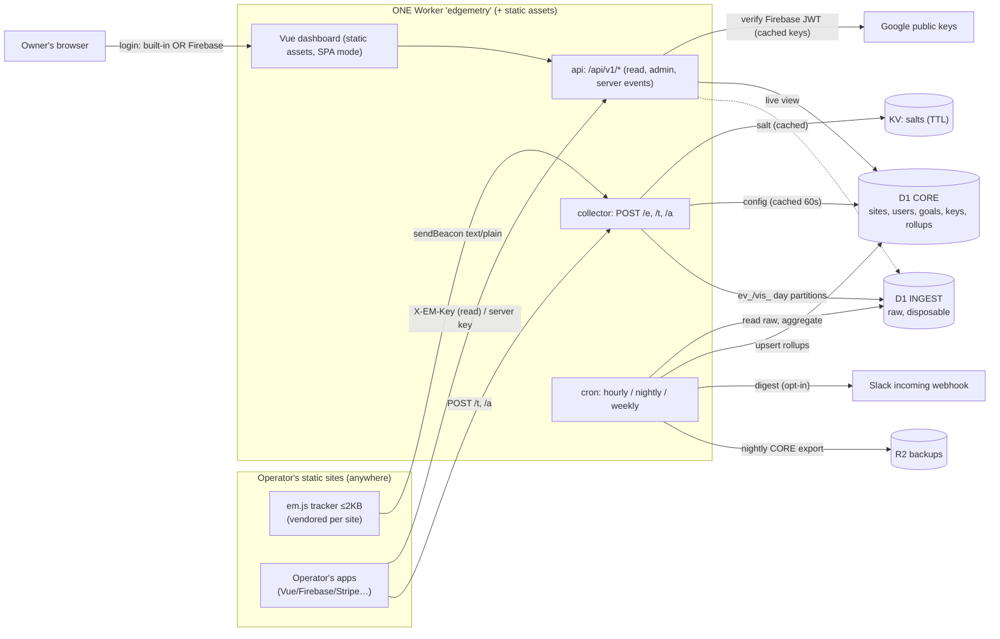

# HeyEddi Edgemetry — Technical Spec (v0.2 draft)

> **PRODUCT RENAMED:** This spec was written for "Edgemetry" but the product has been renamed to **HeyEddi Wispstat**. When reading this spec, mentally substitute "Wispstat" for "Edgemetry" and adjust naming accordingly (e.g., `em.js` → `ws.js`, `edgemetrics` → `wispstat`, etc.). The technical requirements remain unchanged.

Owner: Eddi Sanchez · Date: 2026-10-04 · Status: draft for build · License of the project: **MIT**
Inspired by (MIT) [hayaran/Edgemetry](https://github.com/hayaran/Edgemetry). From-scratch implementation; no upstream code copied (credit in README; see Q-N3 on naming).

**Legend:** ✅ = verified against official docs on 2026-10-04 (URL cited). ⚠️ = unverified / from memory / my assumption. Verify before relying on it.

## Changes from v0.1
1. **Open source (MIT), self-hosted per person on their own Cloudflare account.** Still no hosted SaaS/billing/public signup/multi-tenant hosting. New §12 *Open source & easy setup*: Deploy-to-Cloudflare button, setup script, first-run claim screen, README quick start, privacy-page template, tests, no hard-coded domains.
2. **Single deployable Worker + static assets** (was 3 Workers + Pages). The Deploy button supports Workers apps only (not Pages) and has monorepo limits ✅, so the dashboard ships as Worker static assets; collector/API/cron are modules of one Worker. Resolves the v0.1 "Pages SPA fallback" ⚠️ (Workers assets has an SPA mode ✅).
3. **Random public `site_id`** per site (used as `data-site`), optional friendly `slug` (never accepted by the collector). Used in data model, tracker, collector, API keys (§4, 5, 6, 8).
4. **Pluggable login:** built-in owner email+password (default for self-hosters) or Firebase Auth (Eddi's default) behind one `AuthProvider` interface; `firebase_uid` → provider-qualified `user_id` (§8.1, §12).
5. **Sessions** (cookieless, approximate, same-day) added as v1.1 (§14.1). Core metric renamed `visits` → **`visitors`** (daily visitor) to avoid clashing with sessions.
6. **Event `value`** (optional number; per-site currency) in MVP → revenue per source. Dropped the `cv_` conversion table (conversions/revenue are computed at day close from tagged events joined to visitor-day rows) — one fewer write per conversion. Arbitrary properties still deferred; capped *allowed-properties* design in §14.3.
7. **Server-to-server events** with per-site secret key + short-lived encrypted **visit token** (§14.2), own phase (v1.2).
8. **`lang`** (base language only) added to visitor data, rollups, dashboard; explicit exclusion list of fingerprinting signals (§2.1).
9. **PII policy + CRM integration** (§2.6, §13): no emails in analytics; first-touch source/UTM copied into the CRM by the app; consent records live in the CRM.
10. **Optional consented mode** (per site, OFF by default) with first-party random ID; documented as requiring consent in many jurisdictions and breaking "no banner" (§14.4). Default stays fully cookieless.
11. **Non-goals expanded:** no ad targeting, no selling data, no Privacy Sandbox APIs, no cross-site tracking (§1).
12. Milestones now 8 weeks to v1.0 + phased v1.1–v1.4; answered questions dropped, new ones added (§15–16). New verified facts in Appendix A (Deploy button, wrangler auto-provisioning, Web Crypto, Mexico's 2025 data-protection law).

---

## 1. Goals / Non-goals

**Goals**
1. Cookieless, privacy-first analytics for any number of owned sites (Eddi: climb, egregor-app, nunuvi, helpus, proven3, jobworth, heyeddi, CI.heyeddi.com, buybetter).
2. **Open source (MIT); one self-hosted instance = one person's Cloudflare account.** Runs on Cloudflare free tier (Workers + D1 + KV + static assets), ~$0/month at small traffic; upgrade path to Workers Paid.
3. Growth features: **first-touch attribution per visitor-day** (utm + channel-grouped referrer) so goals/signups/revenue are attributed to a source with per-source conversion rate; goals; optional event `value`; UTM link builder; cross-site overview; CSV/JSON export; opt-in weekly Slack digest; **per-site timezone**.
4. Dashboard = Vue static app served by the same Worker. Small read-only JSON API; per-site scoped keys for embeddable mini dashboards.
5. Easy setup for strangers: Deploy button or one setup script, first-run claim screen, quick-start README.
6. Solo-maintainable: one Worker, two D1 DBs, one KV namespace.

**Non-goals**
- **Not a hosted service:** no billing, no public signup, no multi-tenant hosting of other people's data by the project. Each operator is the data controller for their own instance; the project ships software only (MIT, "as is"). No telemetry/phone-home from the software.
- **No ad targeting, no selling or sharing of data, no Privacy Sandbox APIs (Topics, Attribution Reporting, etc.), no cross-site/cross-device tracking or identity graphs, no remarketing.**
- No personal data in analytics (emails, names, phone, user IDs) — that belongs in a separate CRM (§2.6, §13).
- No fingerprinting (§2.1); no session replay/heatmaps.
- No third-party requests from tracked sites.
- Not product analytics with arbitrary event properties/funnels (capped allowed-properties later, §14.3).
- No sub-minute real-time; "live" = last ~30 min, cached 15 s.

---

## 2. Privacy model

### 2.1 What is / isn't stored

| Data | Handling |
|---|---|
| IP address | Read from `CF-Connecting-IP` in memory only: hashed, and country derived from `request.cf.country` ⚠️. **Never stored, never logged.** |
| User-Agent | In memory only: hashed, and reduced to coarse `device`, `browser` family, `os` family. Raw UA never stored. |
| Visitor ID | `vh` = first 16 bytes of `SHA-256(salt ‖ 0x00 ‖ sid ‖ 0x00 ‖ ip ‖ 0x00 ‖ ua)`. IPv6 truncated to /64. Salt: secret, random, per site per local day, **expires ~6 h after the local day ends**. `sid` in the hash ⇒ no cross-site linking. |
| URL | Pathname only (no query/hash unless `data-hash-mode`); optional masking; ≤256 chars. |
| Referrer | Hostname only. Own-domain referrers ignored. |
| UTM | `utm_source/medium/campaign/content/term` (+ `ref`/`via` fallback), lowercased, ≤100 chars, charset-restricted; email-like values dropped. |
| **Language (`lang`)** | **Base language only** (`es`, `en`, `pt`…): first tag of `navigator.language` (client) with fallback to first tag of `Accept-Language` (server); lowercased, truncated to base subtag, validated `^[a-z]{2,3}$`, else `''`. **Never the full language list, never region.** |
| Timestamps | Server time only. |
| Custom events | Name (≤64, `[a-z0-9_:.-]`) + optional numeric `value` (§5). No other properties in v1.0. |
| **Never collected** | Screen/viewport size, client timezone/offset, installed fonts, plugins, canvas/WebGL/audio, hardware concurrency/memory, battery, connection type, full `navigator.languages`, cookies/localStorage/sessionStorage/IndexedDB (in default mode), client-side IDs, Firebase Analytics, third-party calls, raw IP/UA, emails/user IDs, query strings. Enforced by a test that greps `em.js` for these APIs (§12.7). |

Mitigation for combined entropy (country+device+lang+browser): rollups store **one dimension at a time** (except the source tuple), never cross-tabs; per-visitor rows live ~3 days in INGEST then are dropped.

### 2.2 How visitors are identified without cookies
- **Visitor-day ≡ (site, local salt-day, `vh`).** The first pageview of a `vh` in a day creates one row in `vis_<day>` holding **first-touch** attribution (utm/referrer/channel/country/device/browser/os/lang/entry path). Later pageviews/events/goals that day attach by joining on `vh`.
- Salt window = **site-local day** (not UTC day) so daily visitors align with the owner's reporting day. *Deviation from "same UTC day"; Q1.*
- Salts live in **Workers KV with TTL** (not D1) so D1 Time Travel history can't resurrect them. ⚠️ KV `expirationTtl` not re-verified; fallback = D1 `salts` table with disclosure.

### 2.3 Tradeoffs (document in dashboard "About data")
- Visitors are **daily**; multi-day "visitors" = visitor-days. Shared IP+UA merge; mobile IP change splits; next day = new visitor; no cross-device.
- First-touch-per-day: "direct" at 09:00 then HN at 15:00 is credited to Direct (v1.1 optional "upgrade direct" rule).
- **Multi-day attribution is impossible in default mode** (no stored ID). Signup on day 3 from a day-1 HN visit is credited to the day-3 source. Fix = optional consented mode (§14.4) or the app capturing UTMs itself (§13).
- Bots/spoofing inflate counts but can't expose personal data.

### 2.4 DNT / GPC (optional)
Per-site `honor_dnt` (default off) + tracker `data-respect-dnt`. When on: tracker sends nothing if `navigator.doNotTrack === '1'` or `navigator.globalPrivacyControl === true`; collector drops requests with `DNT: 1` / `Sec-GPC: 1`. (`globalPrivacyControl` is experimental/limited availability ✅ [MDN](https://developer.mozilla.org/en-US/docs/Web/API/Navigator/globalPrivacyControl); the server header is the reliable path.) Consented mode treats GPC as "no consent".

### 2.5 Legal notes — **not legal advice** ⚠️ (get counsel/DPA guidance)
- **GDPR/ePrivacy (EU) — from memory ⚠️:** IP is generally personal data; processed transiently in memory only. Default mode stores/reads nothing on the device, so the ePrivacy consent trigger is arguably not hit, but regulators differ. **Consented mode (§14.4) stores an identifier on the device and in many jurisdictions needs prior opt-in consent (EU ePrivacy Art. 5(3)).**
- **Mexico (LFPDPPP) ⚠️ partially checked:** a new Ley Federal de Protección de Datos Personales en Posesión de los Particulares was published in the DOF on 20 Mar 2025 ✅; per the text I could retrieve, processing of personal data is subject to consent unless an exception applies (Art. 7), consent may generally be tacit when a privacy notice has been made available, but financial data and sensitive data need express consent, and a privacy notice is required (Art. 14/16) ✅ ([law text](https://www.diputados.gob.mx/LeyesBiblio/pdf/LFPDPPP.pdf), only search excerpts read, not the full text). **Whether cookieless daily-hash analytics, or a first-party ID cookie, counts as processing "personal data" under it, and which consent form applies, is NOT verified.** Treat Mexico as open (Q-N8).
- At-rest default data is pseudonymous (`vh`, short-lived) then aggregated; no identifier to action access/erasure requests against (document). In consented mode, erasure is supported by `cid` (§14.4).
- **Retention disclosure must include Time Travel:** raw rows dropped from the live DB in ~3 days remain in D1 point-in-time history for up to 7 days (Free) / 30 days (Paid) ✅ (§10).
- The repo ships a privacy-page template (§12.6); each operator is responsible for their own notice and legal basis.
- Never enable Workers Logs/Logpush on the collector path without checking they don't capture IPs (§11).

### 2.6 PII policy (hard rule)
Emails, names, phones, CRM/contact IDs, Firebase UIDs and payment details **never** enter analytics: not in event names, utm values, paths, `value`, or S2S payloads. Enforced by (a) strict schemas (unknown fields rejected on the S2S endpoint), (b) email-like/`@` value rejection, (c) path masking, (d) a fuzz test that scans all tables for email/IP/UA patterns. The only personal data in an instance is the **operator's own login** (email for built-in auth) in `users` — admin account data, not visitor data. Details of the CRM split in §13.

---

## 3. Architecture



**Components**
- **One Worker, four modules** (collector, api, cron, assets). Why not three Workers (v0.1): Deploy-to-Cloudflare handles one Workers app per repo/subdirectory and doesn't deploy monorepos' multiple Workers together ✅; a single deploy is simpler for strangers. Cost: no per-Worker binding least-privilege — mitigated by module boundaries and by never exposing raw INGEST data through the API except `live`.
- **Two D1 DBs** (Free allows 10 ✅): `INGEST` (raw per-day partitions; disposable; not backed up) and `CORE` (config + rollups + users; backed up). Export blocks a DB while running ✅, so splitting keeps ingestion alive during CORE backups.
- **KV** `SALTS`. **R2** `BACKUPS` (optional).
- **No hard-coded hostnames anywhere:** base URL is derived from the request (`new URL(request.url).origin`) or the optional `PUBLIC_BASE_URL` var; the tracker defaults its collector URL to its own script origin (§5). A custom domain is recommended: Cache API is only functional on custom domains (and Pages Functions) ✅ — treat `workers.dev` as uncached ⚠️.
- Eddi's instance: Worker custom domain (a subdomain of a domain he owns), `AUTH_PROVIDERS=firebase`.

---

## 4. Data model

Conventions: `sid` = internal integer; **`site_id` = public random ID**; `day` = `YYYY-MM-DD` in the site's timezone; partition suffix `YYYYMMDD` of that local date; `ts` = unix seconds UTC. Composite-PK `WITHOUT ROWID` tables: **every secondary index costs an extra row written per insert** ✅.

### 4.0 Site IDs
- `site_id` = `s_` + 16 chars Crockford base32 from `crypto.getRandomValues` ✅ (80 bits), generated at site creation; shown in the "Add site" snippet; **this** is `data-site`. It is an *identifier, not a secret* (it sits in public HTML): it prevents enumeration/blind spam of other sites, but ingest protection still relies on origin check + rate limits (§11).
- `slug` (optional, `^[a-z0-9-]{2,40}$`, unique) and `name` are for humans: dashboard URLs, digest titles, API path convenience (`/sites/{site_id|slug}`; slug resolved only within the caller's authorized sites). **The collector, `/t`, `/a` and keys accept `site_id` only.**
- API keys embed the site ID: `emk_<site_id>_<secret>` (read) / `ems_<site_id>_<secret>` (server, §14.2); a key is rejected if its embedded `site_id` ≠ the key row's site.

### 4.1 CORE (config + rollups; kept forever unless noted)
```sql
CREATE TABLE sites (
  sid INTEGER PRIMARY KEY, site_id TEXT UNIQUE NOT NULL,   -- public random id
  slug TEXT UNIQUE, name TEXT NOT NULL,
  domains TEXT NOT NULL,                                   -- JSON array of allowed hostnames
  tz TEXT NOT NULL DEFAULT 'UTC',                          -- IANA; set at creation (default from instance config); whole-hour offsets only in v1
  currency TEXT NOT NULL DEFAULT 'USD',                    -- ISO 4217; ONE currency per site for event `value`
  honor_dnt INTEGER NOT NULL DEFAULT 0, ingest_paused INTEGER NOT NULL DEFAULT 0,
  digest_enabled INTEGER NOT NULL DEFAULT 0,
  sessions_enabled INTEGER NOT NULL DEFAULT 0,             -- v1.1
  consent_mode INTEGER NOT NULL DEFAULT 0,                 -- v1.4; OFF by default
  created_at INTEGER NOT NULL);

CREATE TABLE users (                                       -- operators only (never visitors)
  user_id TEXT PRIMARY KEY,                                -- 'local:<n>' | 'fb:<firebase uid>' | '<provider>:<id>'
  provider TEXT NOT NULL, email TEXT, pw_hash TEXT,        -- email/pw_hash only for provider='local'
  role TEXT NOT NULL CHECK (role IN ('owner','viewer')), created_at INTEGER NOT NULL);

CREATE TABLE login_sessions (                              -- built-in auth only
  token_hash BLOB PRIMARY KEY, user_id TEXT NOT NULL, created_at INTEGER NOT NULL,
  expires_at INTEGER NOT NULL, auth_time INTEGER NOT NULL) WITHOUT ROWID;

CREATE TABLE instance (k TEXT PRIMARY KEY, v TEXT NOT NULL) WITHOUT ROWID;   -- 'claimed','schema_version','instance_id'

CREATE TABLE site_members (
  sid INTEGER NOT NULL, user_id TEXT NOT NULL,
  role TEXT NOT NULL CHECK (role IN ('owner','viewer')),
  PRIMARY KEY (sid, user_id)) WITHOUT ROWID;

CREATE TABLE api_keys (
  key_id TEXT PRIMARY KEY, sid INTEGER NOT NULL,
  kind TEXT NOT NULL CHECK (kind IN ('read','server')),
  label TEXT, key_hash BLOB NOT NULL,                      -- SHA-256 of secret; shown once
  scopes TEXT NOT NULL, allowed_origins TEXT NOT NULL,     -- origins used for 'read' keys only
  created_at INTEGER NOT NULL, last_used_day TEXT, revoked_at INTEGER);

CREATE TABLE goals (
  goal_id INTEGER PRIMARY KEY, sid INTEGER NOT NULL, name TEXT NOT NULL,
  kind TEXT NOT NULL CHECK (kind IN ('event','path')),
  match_type TEXT NOT NULL CHECK (match_type IN ('exact','prefix')),
  pattern TEXT NOT NULL,
  active INTEGER NOT NULL DEFAULT 1, created_at INTEGER NOT NULL,
  UNIQUE (sid, kind, pattern));                            -- one goal per event name/path (v1.0)

CREATE TABLE utm_links (
  id INTEGER PRIMARY KEY, sid INTEGER NOT NULL, label TEXT, base_url TEXT NOT NULL,
  utm_source TEXT, utm_medium TEXT, utm_campaign TEXT, utm_content TEXT, utm_term TEXT,
  full_url TEXT NOT NULL, created_at INTEGER NOT NULL);

-- Rollups
CREATE TABLE stats_hourly (                                -- UTC hour buckets; 90-day retention
  sid INTEGER NOT NULL, hour_ts INTEGER NOT NULL,
  pv INTEGER NOT NULL DEFAULT 0, ev INTEGER NOT NULL DEFAULT 0, new_visitors INTEGER NOT NULL DEFAULT 0,
  PRIMARY KEY (sid, hour_ts)) WITHOUT ROWID;

CREATE TABLE stats_daily (
  sid INTEGER NOT NULL, day TEXT NOT NULL,
  dim TEXT NOT NULL,   -- total|path|entry|ref_host|country|device|browser|os|lang|event
  k TEXT NOT NULL,     -- value ('' for total); top-N + '(other)'
  pv INTEGER NOT NULL DEFAULT 0, visitors INTEGER NOT NULL DEFAULT 0, events INTEGER NOT NULL DEFAULT 0,
  PRIMARY KEY (sid, day, dim, k)) WITHOUT ROWID;

CREATE TABLE sources_daily (
  sid INTEGER NOT NULL, day TEXT NOT NULL, channel TEXT NOT NULL,
  source TEXT NOT NULL DEFAULT '', medium TEXT NOT NULL DEFAULT '', campaign TEXT NOT NULL DEFAULT '',
  visitors INTEGER NOT NULL, pv INTEGER NOT NULL,
  PRIMARY KEY (sid, day, channel, source, medium, campaign)) WITHOUT ROWID;

CREATE TABLE goals_daily (
  sid INTEGER NOT NULL, day TEXT NOT NULL, goal_id INTEGER NOT NULL, channel TEXT NOT NULL,
  source TEXT NOT NULL DEFAULT '', medium TEXT NOT NULL DEFAULT '', campaign TEXT NOT NULL DEFAULT '',
  converters INTEGER NOT NULL,                 -- distinct visitors that converted
  conversions INTEGER NOT NULL,                -- total matching events/hits
  value_x100 INTEGER NOT NULL DEFAULT 0,       -- SUM(event value) in hundredths of site currency
  PRIMARY KEY (sid, day, goal_id, channel, source, medium, campaign)) WITHOUT ROWID;

CREATE TABLE rollup_state (job TEXT NOT NULL, scope TEXT NOT NULL, value TEXT NOT NULL,
  PRIMARY KEY (job, scope)) WITHOUT ROWID;
```
Per-source conversion rate = `converters / visitors` on the same source tuple; **revenue per source** = `value_x100 / 100` (site currency) by tuple; revenue per visitor = value ÷ visitors. Later-phase tables (`sessions_daily`, `prop_defs`/`props_daily`, `consented_visitors`) are in §14.

### 4.2 INGEST (raw; per **local-date** partitions created ahead by cron and **dropped** ~3 days later)
```sql
CREATE TABLE ev_20261004 (
  id INTEGER PRIMARY KEY,                   -- rowid = rollup watermark
  sid INTEGER NOT NULL, ts INTEGER NOT NULL,
  k INTEGER NOT NULL,                       -- 0 pageview, 1 custom event
  name TEXT, path TEXT NOT NULL, vh BLOB NOT NULL,
  nv INTEGER NOT NULL DEFAULT 0,            -- 1 if this pageview started the visitor-day
  goal_id INTEGER,                          -- tagged at ingest from cached goals (NULL = none)
  value_x100 INTEGER,                       -- optional event value ×100 (integer; NULL = none)
  src INTEGER NOT NULL DEFAULT 0);          -- 0 browser beacon, 1 server (v1.2)

CREATE TABLE vis_20261004 (                 -- one row per visitor-day = FIRST-TOUCH attribution
  sid INTEGER NOT NULL, vh BLOB NOT NULL, first_ts INTEGER NOT NULL,
  channel TEXT NOT NULL, source TEXT, medium TEXT, campaign TEXT, content TEXT, term TEXT,
  ref_host TEXT, entry_path TEXT, country TEXT, lang TEXT, device TEXT, browser TEXT, os TEXT,
  PRIMARY KEY (sid, vh)) WITHOUT ROWID;
```
KV: `salt:{sid}:{YYYYMMDD}` → 32 random bytes, TTL so it expires ≤ ~6 h after that local day ends; created by cron up to 24 h ahead (avoids KV negative-cache/eventual-consistency races ✅ [KV](https://developers.cloudflare.com/kv/concepts/how-kv-works/)).

### 4.3 Attribution approach (fixes Edgemetry's gap)
1. Pageview → collector computes `vh`, channel/source/medium/campaign, `lang`, etc. and runs one `db.batch` (a transaction ✅):
   ```sql
   -- 1) event row; nv computed BEFORE the visitor-day insert; goal_id from cached goals (path goals)
   INSERT INTO ev_D (sid,ts,k,path,vh,nv,goal_id)
     VALUES (?,?,0,?,?, NOT EXISTS (SELECT 1 FROM vis_D WHERE sid=? AND vh=?), ?);
   -- 2) first-touch row; inserts 0 rows (no write) if it already exists
   INSERT INTO vis_D (...) SELECT ?,?,?,... WHERE NOT EXISTS (SELECT 1 FROM vis_D WHERE sid=? AND vh=?);
   ```
2. Custom event → one `ev_D` row with `k=1, name, goal_id (matched by name), value_x100`. No extra write for conversions (v0.1 wrote a `cv_` row; removed).
3. **Day close** (cron): join tagged events to visitor-days:
   `SELECT v.channel,v.source,v.medium,v.campaign, e.goal_id, COUNT(DISTINCT e.vh) converters, COUNT(*) conversions, SUM(e.value_x100) value FROM ev_D e JOIN vis_D v ON v.sid=e.sid AND v.vh=e.vh WHERE e.goal_id IS NOT NULL GROUP BY …` → `goals_daily`; events without a visitor-day row get channel `(unknown)`. `sources_daily` ← GROUP BY `vis_D` (+ pv via join).
4. Non-retroactive: goals and channel map apply at ingest; raw lives ~3 days so only a 3-day recompute window.
5. `INSERT … WHERE NOT EXISTS` is meant to make "no write when present" deterministic: D1 defines rows written as rows actually inserted/updated/deleted ✅; confirm the no-op case in the spike ⚠️.

### 4.4 Channel grouping (`channels.json`, versioned in repo)
Precedence: (1) `utm_medium` ∈ {cpc,ppc,paid*} → **Paid**; `email|newsletter` → **Email**; (2) `utm_source` alias map (twitter|x|t.co→X, hn|hackernews→Hacker News, …); (3) referrer host map; (4) **Direct**. Self-referral (host ∈ site.domains) ignored. Referrer host in *another site of the same instance* → **Own sites**.
Channels: Direct · Organic Search · Hacker News · X · Reddit · LinkedIn · Dev.to · Product Hunt · GitHub · YouTube · Facebook/Instagram · Mastodon/Bluesky/Threads · Medium/Hashnode · Indie Hackers/Lobsters · AI assistants · Email · Paid · Own sites · Referral · (unknown). Mapping stored on the visitor-day row at ingest, with `ref_host` and raw utm.

### 4.5 Timezone handling
- Each site has `tz` (IANA); default for new sites comes from instance config (`DEFAULT_TZ`, falls back to `UTC`). Local day via `Intl.DateTimeFormat('en-CA',{timeZone})` ⚠️ (workerd Intl not re-verified) → partition, salt key, `day`.
- `stats_hourly` is UTC-hour bucketed; API converts to local hours (whole-hour offsets only in v1). DST days fall out of the local-date logic. For Mexico City: no DST currently ⚠️ (verify tzdata).
- Daily rollups at **local-day close + 60 min grace**. Cron is UTC-only ✅ ([Cron Triggers](https://developers.cloudflare.com/workers/configuration/cron-triggers/)); jobs decide per site what's closed.

### 4.6 Write-budget math (Free: 100,000 rows written/day, resets 00:00 UTC ✅ [D1 pricing](https://developers.cloudflare.com/d1/platform/pricing/))
Counting ✅: each inserted/updated/deleted row = 1; each secondary index entry = +1. No secondary indexes.

Per pageview: `1 + 1/ppv` (ppv = pageviews per visitor-day) ≈ **1.6 at ppv=1.6**. Per custom event: 1 (value/goal tag are columns, free). Conversions: 0 extra. Overhead/day (estimate; measure in spike): hourly upserts ≈ sites×24; daily rollup rows ≈ sites × ~100–400; partition DDL (⚠️ unknown). Reserve **5k** + 10% headroom. Per instance (each self-hoster has their own account caps).

| Pageviews/day | Custom events | Writes/day ≈ | % of 100k |
|---|---|---|---|
| 5,000 | 500 | 5,000×1.625 + 500 + 5,000 = ~13.6k | 14% |
| 20,000 | 3,000 | 32.5k + 3k + 5k = ~40.5k | 41% |
| 50,000 | 5,000 | 81.3k + 5k + 5k = ~91.3k | 91% ⚠️ ceiling |

Ceiling ≈ **50k pageviews/day** per instance. Others that may bind first:
- **Workers Free: 100,000 requests/day for the whole account** ✅ ([limits](https://developers.cloudflare.com/workers/platform/limits/)) incl. beacons, `/t`, `/a`, API calls, crons, other Workers in that account. Static-asset requests (dashboard, `em.js`) may be billed differently ⚠️ unverified; keep `run_worker_first` limited to dynamic paths.
- D1 over limit ⇒ queries error for the account ✅ → collector fails silent (204), sheds load; budget gauge in dashboard.
- Reads 5M/day ✅; storage Free 500 MB/DB, 5 GB/account ✅ (stats_daily ≈ 500k rows/yr for 9 sites ≈ 50–80 MB ⚠️).
- Upgrade: Workers Paid removes daily caps (50M rows written/mo included ✅; price ⚠️ not fetched).
- Extra writes by later phases: consented mode +1/consented-visitor/day; S2S events +2 each (event + idempotency row); sessions +0 at ingest.

---

## 5. Tracker script API

**Install:** the "Add site" screen shows a snippet with the instance's own origin and the new `site_id` (vendoring `em.js` into the site's build is preferred: same-origin, cached by the site's CDN).
```html
<script defer src="https://YOUR-INSTANCE/em.js" data-site="s_k7q2m9x4t8p3w6ab"></script>
```
`data-api` defaults to the **script's own origin + `/e`** (no domain literals in code).

| Attribute | Default | Meaning |
|---|---|---|
| `data-site` | required | the random public **site ID** (`s_…`), never the slug |
| `data-api` | script origin + `/e` | collector URL |
| `data-spa` | `auto` | patch `history.pushState/replaceState` + `popstate`; `off` = manual |
| `data-hash-mode` | off | include `location.hash` path |
| `data-auto` | `true` | `false` = no automatic pageviews |
| `data-respect-dnt` | off | honor DNT/GPC client-side |
| `data-exclude` | — | path prefixes never sent |
| `data-mask` | — | path patterns to collapse (`/u/*` → `/u/:x`) |

**JS API**
```js
edgemetry('pageview')
edgemetry('event', 'signup')
edgemetry('event', 'purchase', { value: 49.9 })   // optional numeric value in the SITE's currency
// reserved, not implemented in v1.0: props
// v1.1: edgemetry('attribution') -> Promise<{channel,source,medium,campaign,content,term}>   (§13)
// v1.2: edgemetry('token')       -> Promise<string>   (short-lived visit token, §14.2)
```
- `value`: finite number, `0 ≤ value ≤ 1e9`, rounded to 2 decimals; anything else → event sent without value. No currency argument in the browser API: currency is a **site setting** (one per site; multi-currency is out of scope for v1). Any other key in the options object is ignored (arbitrary properties are deferred, §14.3).
- Queue stub before load: `window.edgemetry = window.edgemetry || function(){(edgemetry.q=edgemetry.q||[]).push(arguments)}`.
- Transport: `navigator.sendBeacon(api, new Blob([json], {type:'text/plain'}))` (no CORS preflight; 64 KiB cap ✅ [MDN](https://developer.mozilla.org/en-US/docs/Web/API/Navigator/sendBeacon)); fallback `fetch(..., {keepalive:true})`.
- Payload (<1 KB): `{s:<site_id>, k:'pv'|'ev', n, p, r, l, v, us, um, uc, ut, ux, rf}`. `l` = base language from `navigator.language`. `v` = value. **Not sent:** screen/viewport size, timezone, fonts, plugins, `navigator.languages`, hardware info, query string, hash.
- SPA: pv on route change (debounced 50 ms, deduped); `r` only on first pageview of a load.
- Skips: prerender, `navigator.webdriver`, excluded paths, DNT/GPC (if enabled), `localhost`/`file:`.
- ≤2 KB gzipped, no dependencies, errors swallowed. **The default build contains no cookie/storage code** (the consented build is a separate file, §14.4).
- Host-site CSP must allow `connect-src https://YOUR-INSTANCE`.

---

## 6. Collector endpoints

### 6.1 `POST /e` (beacon; also `OPTIONS`)
- Body JSON ≤2 KB. Responses: `204` accepted **or silently dropped**; `400` malformed; `413`; `429`. `Cache-Control: no-store`; **never `Set-Cookie`**. CORS: `Access-Control-Allow-Origin` = validated Origin, `Vary: Origin`; preflight `204`. ⚠️ Beacon CORS behavior per browser: test in spike.
- Pipeline:
  1. Validate size/JSON/fields (`s` must match `^s_[a-z2-9]{16}$`; `p` starts with `/`; `n` charset; `l` regex; `v` numeric range).
  2. Site lookup **by `site_id`** from isolate cache (60 s TTL, stale on D1 error); unknown/`ingest_paused` ⇒ 204 drop (no D1 write).
  3. Origin/Referer host ∈ `site.domains`; else drop.
  4. DNT/GPC if `honor_dnt`; bot filter (UA regex, empty UA; optional hosting-ASN via `request.cf.asn` ⚠️).
  5. Rate limit: Rate Limiting binding keyed `site_id` and `site_id`+coarse IP-hash (memory only). Semantics ✅: period 10 or 60 s; per-location; permissive ([docs](https://developers.cloudflare.com/workers/runtime-apis/bindings/rate-limit/)).
  6. Salt (isolate → KV); `vh`; local day; channel; device/browser/os; country; `lang` (client `l`, else `Accept-Language` first tag → base).
  7. `204` immediately; D1 batch in `ctx.waitUntil` (≤30 s ✅). On `no such table` create partition and retry once. On D1 limit error: drop + shed flag 60 s.
  8. Event-name cardinality guard: ≤100 distinct names/site/day (`(other)` beyond).
- Free: 10 ms CPU/request ✅ — measure in spike ⚠️.

### 6.2 `POST /t` (v1.2) and `POST /a` (v1.1)
Same validation/CORS/rate limits as `/e`, but they return JSON (called with `fetch`, not beacon). `/t` mints a visit token (§14.2); `/a` returns the caller's **own** same-day first-touch (`channel, source, medium, campaign, content, term, ref_host`) looked up via the caller's `vh` — no identifiers returned (§13). Both are read-only on D1 (no writes) but still count as Worker requests ✅.

### 6.3 `POST /api/v1/server/events` (v1.2)
Server-to-server; see §14.2.

---

## 7. Rollup jobs (cron inside the same Worker)

Free: **5 cron triggers/account**, 10 ms CPU per cron invocation, 15 min wall ✅; changes take ≤15 min to propagate ✅. SQL does aggregation; JS shuttles small result sets; CORE upserts use **one statement with `json_each(?1)`** (⚠️ verify) because D1 allows 100 bound params/statement and 50 queries/invocation (Free) ✅ (batch statement counting ⚠️). Aggregations are site-agnostic (`GROUP BY sid`).

| Job | Cron (UTC) | Work |
|---|---|---|
| `hourly` | `5 * * * *` | (a) ensure `ev_/vis_` partitions for today+tomorrow per distinct site-local date; (b) incremental `stats_hourly` via `id` watermark → additive upsert + watermark in one CORE batch; (c) **close days** (site-local day ended ≥60 min ago): compute `stats_daily` (dims incl. `lang`; top-N + `(other)`), `sources_daily`, `goals_daily` (with `conversions`, `value_x100`) from partition D with replace-upserts (idempotent); (d) **`DROP TABLE`** partitions ≤ today−3 once done (DELETE costs 1 write/row ✅); (e) pre-create next-day salts in KV; (f) prune `stats_hourly` >90 d and expired `login_sessions`. |
| `nightly` | `0 9 * * *` (default; set per instance) | CORE export → R2 (§10), prune old exports. |
| `weekly` | `0 15 * * MON` (default; set per instance) | Slack digest (opt-in). Weekday names (numeric DOW 1=Sunday ✅). |

Uses 3 of 5 triggers (other Workers on the account share the 5). Nightly/weekly defaults live in `edgemetry.config`; the operator can change them. Live "today" views are computed from raw partitions on demand and cached 15–60 s.

---

## 8. Read API (`/api/v1`)

All dates are **site-local** `YYYY-MM-DD` inclusive; `{site}` = `site_id` or `slug` (resolved within the caller's authorized sites).

### 8.1 Auth — pluggable
```ts
interface AuthProvider {
  id: string;                                     // 'local' | 'firebase' | custom
  authenticate(req: Request, env: Env): Promise<{ userId: string; authTime: number } | null>;
  // optional: routes for login/logout (local) or config for the SPA (firebase)
}
```
Config: `AUTH_PROVIDERS` (default `local`; Eddi: `firebase`; both allowed). Authorization is provider-independent: `userId ∈ site_members` for the site, or role `owner` instance-wide.

1. **`local` (default for self-hosters).** Owner email + password created at claim (§12.3). Password hash = **PBKDF2-SHA256 via Web Crypto** ✅ (supported in Workers) with per-user random salt; iterations configurable (`PBKDF2_ITERATIONS`, default 100000 ⚠️ — Workers' iteration cap and the Free 10 ms CPU fit are unverified; measure; Q-N4). Login → opaque 256-bit session token, **only its hash stored** (`login_sessions`), sent as `__Host-em_session` cookie (`HttpOnly; Secure; SameSite=Strict; Path=/`, 7-day sliding). *This cookie exists only on the operator's dashboard origin; the tracker never sets or reads cookies on tracked sites.* CSRF defenses for cookie auth: SameSite=Strict, `Origin` must equal the instance origin, JSON-only bodies + custom header `X-EM-CSRF`. Rate-limited login with delays; constant-time compares via `crypto.subtle.timingSafeEqual` ✅. Password reset: CLI `pnpm owner:reset` (no outbound email in OSS); see §12.3.
2. **`firebase` (optional; Eddi's default).** `Authorization: Bearer <Firebase ID token>`; verify per Firebase docs ✅ ([verify-id-tokens](https://firebase.google.com/docs/auth/admin/verify-id-tokens)): RS256; `kid` ∈ keys from `https://www.googleapis.com/robot/v1/metadata/x509/securetoken@system.gserviceaccount.com` (cache per `max-age`); `aud` = project ID; `iss` = `https://securetoken.google.com/<projectId>`; `sub` non-empty; `exp/iat/auth_time`. Admin SDK needs Node + service account → use WebCrypto/`jose` ⚠️. `FIREBASE_PROJECT_ID` (+ public `FIREBASE_WEB_CONFIG` served to the SPA, which lazy-loads the Firebase SDK only in this mode). **Revocation is not checked ✅** ⇒ admin actions require `auth_time` ≤ 5 min. UID allowlist via `users`/`site_members` (`fb:<uid>`).
3. **Embeds:** `X-EM-Key: emk_<site_id>_<secret>`; SHA-256(secret) compared constant-time to `api_keys.key_hash`; checks `kind='read'`, `revoked_at`, `scopes`, `Origin ∈ allowed_origins`, URL site == key site. Read-only, aggregate-only, one site, no export/admin. Treat as semi-public.
4. **Server keys** (`ems_…`, §14.2) are valid only on the S2S endpoint.

### 8.2 Endpoints
| Method & path | Auth | Returns |
|---|---|---|
| `GET /config` | none | public: enabled providers, Firebase web config, claimed flag |
| `POST /auth/login`, `/auth/logout` | local | session |
| `GET /sites` | user | sites the user may see (`site_id, slug, name, tz, currency`) |
| `GET /overview?from&to&compare=prev` | user | cross-site cards: visitors, pv, goals, revenue, Δ%, sparkline |
| `GET /sites/{site}/summary` | user/key | visitors, pv, events, goal totals, revenue, vs previous |
| `GET /sites/{site}/timeseries?metric=pv\|visitors\|events\|revenue&grain=hour\|day\|week\|month` | user/key | local buckets |
| `GET /sites/{site}/breakdown?dim=path\|entry\|ref_host\|country\|lang\|device\|browser\|os\|event` | user/key | `{k, pv, visitors, events}` |
| `GET /sites/{site}/sources?level=channel\|source\|campaign&goal={id}` | user/key | `{channel,source,medium,campaign,visitors,pv,converters,conv_rate,conversions,value,revenue_per_visitor}` |
| `GET /sites/{site}/goals` · `GET /sites/{site}/goals/{id}/conversions?by=…` | user/key | per-source conversions/rate/revenue |
| `GET /sites/{site}/live` | user | last 30 min (from raw) |
| `GET /sites/{site}/export?dataset=daily\|sources\|goals&format=csv\|json` | **user only** | rollups only; ≤50k rows; CSV formula-injection guard |
| Admin (owner, recent auth): sites (create returns new `site_id`), goals, api-keys (read/server), members, utm-links, digest, instance settings | user | CRUD |

Envelope `{site:{site_id,slug}, tz, currency, from, to, grain, data, generated_at, ttl}`; errors `{error:{code,message}}`.

### 8.3 CORS
`Access-Control-Allow-Origin` echoed only if allowed (instance origin for dashboard; key `allowed_origins` for keys), `Vary: Origin`, headers `Authorization, X-EM-Key, X-EM-CSRF, Content-Type`, no credentials for key calls.

### 8.4 Caching
Authenticate first, then `caches.default` keyed by canonical URL + scope marker. Cache API: custom domains only; per-data-center; no `stale-while-revalidate` in `put/match` ✅ ([Cache API](https://developers.cloudflare.com/workers/runtime-apis/cache/)). TTLs: live 15 s; includes-today 60 s; closed ranges 1 h. `Cache-Control: private, max-age=15..60`, `ETag`.

---

## 9. Dashboard (Vue 3, static assets of the Worker)

Vue 3 + Vite + vue-router + Pinia; self-hosted chart lib (no CDN). Served via Workers Static Assets with `not_found_handling: "single-page-application"` ✅ and `run_worker_first` for `/e`, `/t`, `/a`, `/api/*`; `_headers` for CSP / `frame-ancestors 'none'` (static-assets `_headers`: 100 rules ✅). Strings rendered as text only.

Views
1. **First run:** *Claim this instance* → add first site → snippet (§12.3).
2. **Overview (cross-site):** cards per site; Δ vs previous; health.
3. **Site overview:** range picker (site tz), timeseries, KPIs (visitors, pv, goals, **revenue** if a value goal exists), top pages, sources, countries, **languages**, devices.
4. **Live.**
5. **Sources:** channel → source/medium/campaign; visitors, **converters, conversion rate, revenue, revenue/visitor** for a selected goal.
6. **Goals** (event/path; revenue goal = event goal where `value` is sent).
7. **Pages / Events / Languages** breakdowns.
8. **UTM Link Builder** (validates base URL ∈ site.domains; normalization; channel presets; save/copy).
9. **Export** (CSV/JSON).
10. **Settings:** site (name, slug, **site ID (copy)**, tz, currency, domains, DNT, pause), goals, API keys (read/server; create-once reveal), members, Slack digest, **auth providers**, consented-mode toggle (v1.4, with a consent warning), sessions toggle (v1.1).
11. **Data budget:** est. writes/requests today vs Free caps, shed indicator, last backup.
12. **Embeddable `<EdgemetryMini>`** (key-scoped).

Slack digest (weekly, opt-in per site): visitors/pv Δ, top sources with conv rate and revenue, top pages, goals, anomaly flag. Slack incoming webhook (secret URL; fixed channel ✅ [Slack](https://docs.slack.dev/messaging/sending-messages-using-incoming-webhooks/)) stored as Worker secret; no personal data.

---

## 10. Backup plan for D1

### 10.1 Time Travel ✅ — [Time Travel](https://developers.cloudflare.com/d1/reference/time-travel/) · [Limits](https://developers.cloudflare.com/d1/platform/limits/)
- Always on, free, automatic bookmarks; restore to any minute within **30 days (Paid) / 7 days (Free)** (the Time Travel page headline says 30 days; Limits + Notes say Free = 7).
- Needs `version: production` DB; Wrangler ≥ 3.4.0. Restore is **destructive in place**, returns an undo bookmark; max 10 restores/10 min/DB; no clone/fork yet.
- `wrangler d1 time-travel info <CORE> [--timestamp=…]` / `restore <CORE> --timestamp=<unix>`.
- Caveats: short window, not an archive; history includes raw pseudonymous INGEST rows (disclose §2.5); salts are in KV so not in history. Consented-mode records (CORE) are in history too — relevant to erasure promises (§14.4).

### 10.2 Logical export to R2 ✅ pattern
- Nightly job: D1 export REST API `POST /accounts/{id}/d1/database/{db}/export` (poll `current_bookmark` until `signed_url`) → stream SQL to R2. Official example is a Workflow with `schedules` ([guide](https://developers.cloudflare.com/workflows/examples/backup-d1/)); Workflows limits table has a Free column ✅ ([limits](https://developers.cloudflare.com/workflows/reference/limits/)); a plain poll loop in the cron handler is the simpler option (⚠️ pick after spike). Needs an API token secret (`CF_API_TOKEN` + `CF_ACCOUNT_ID`; permission name ⚠️). **Optional** feature: off unless configured — the setup script asks.
- **CORE only.** A running export blocks other requests to that DB ✅ → run off-peak; collector serves stale config from cache.
- R2 Free tier 10 GB-month / 1M Class A / 10M Class B ✅ ([R2](https://developers.cloudflare.com/r2/pricing/)); retention 30 daily + 12 monthly; deletes free ✅.
- `wrangler d1 export --table/--no-data` available ✅ ([import/export](https://developers.cloudflare.com/d1/best-practices/import-export-data/)).

### 10.3 Offline copy & drills
Monthly manual `wrangler d1 export CORE --remote`; quarterly restore drill into a scratch D1 (5 GiB file limit; 100 KB/statement ⇒ split inserts ✅). RPO ≈ 1 min via Time Travel (≤7 d Free), ≤24 h via R2; RTO < 1 h. Record a Time Travel bookmark before each migration.

---

## 11. Security

| Threat | Mitigation |
|---|---|
| **Ingest abuse / inflation / budget exhaustion** | `site_id` is public ⇒ anyone can POST. Layers: 2 KB cap; strict validation; unknown-site drop with no write; Origin/Referer allowlist; Rate Limiting binding per site and coarse IP-hash (per-colo, permissive ✅); `ingest_paused` kill switch; cardinality caps; shed mode; anomaly flag in digest; optional WAF rate rule ⚠️. The unguessable ID only blocks enumeration. |
| **Domain forgery** | `Origin` is trivially spoofed outside browsers ⇒ stats can be skewed, data can't be read. Purge a bad day by deleting `*_daily` rows (raw only ~3 days). |
| **Claim hijack** | A freshly deployed instance is claimable by whoever reaches it first ⇒ claim requires **`SETUP_TOKEN`** secret (§12.3); claim is atomic (`UPDATE instance SET v='1' WHERE k='claimed' AND v='0'`) and disabled afterward; rate-limited; no default credentials. |
| **Built-in auth** | PBKDF2 hashes ✅; hashed session tokens; `__Host-` HttpOnly SameSite=Strict cookie; CSRF header + Origin check; login rate limit; owner password policy (≥12 chars); no email reset (CLI only). |
| **Firebase auth** | ID token fully validated ✅; UID allowlist; no revocation check ✅ ⇒ reauth for admin; `aud/iss` pinned to configured project. |
| **API keys** | hashed; scoped to one site/kind; origin-restricted (read); rotate/revoke; server keys write-only, never in browsers. |
| **Visit token (v1.2)** | AEAD-encrypted, short-lived, same-day; no PII; S2S key required to use it (§14.2). |
| **Data poisoning / XSS / CSV injection** | Normalization, length/charset caps, email-like rejection; dashboard text-only rendering; CSV formula guard; strict CSP. |
| **PII leakage** | §2.6 hard rule + fuzz test; `data-mask`/`data-exclude`. |
| **SQL injection** | Bound params; dynamic identifiers only server-built `YYYYMMDD`. |
| **Secrets** | `SESSION_SECRET`, `TOKEN_KEY`, `SETUP_TOKEN`, optional `SLACK_WEBHOOK_URL`, `CF_API_TOKEN`; Free: 64 vars/Worker, 5 KB each ✅. Generated by setup script, never logged, never in git (`.dev.vars*` gitignored). |
| **Logs = privacy at rest** | Don't enable Workers Logs/Logpush on collector unless verified to omit IP/UA/URL ⚠️ (`observability` is a wrangler setting ✅ — ship with it disabled for collector routes); log counters only. |
| **Supply chain (OSS)** | Few deps; lockfile; CI audit; optional signed releases ⚠️; SECURITY.md with private reporting; no remote code or phone-home. |

---

## 12. Open source & easy setup

Goal: a stranger with a Cloudflare account gets a working, claimed instance in minutes, without editing code.

### 12.1 Repository (MIT; single Workers app)
```
wrangler.jsonc            # bindings by name only (no IDs), assets, crons, vars
edgemetry.config.ts       # THE ONLY config module (defaults, env parsing, limits)
.dev.vars.example         # secrets declared here (used by Deploy button)
src/{collector,api,cron,auth,lib}/
channels.json
dashboard/                # Vue app -> built into assets dir
tracker/{em.js,em-consent.js}
migrations/{core,ingest}/ # per-binding migrations_dir
scripts/{setup.mjs,smoke.mjs,load.mjs,owner-reset.mjs}
templates/privacy-page.md
tests/  .github/workflows/ci.yml
README.md LICENSE (MIT) SECURITY.md CONTRIBUTING.md
```
Source must be in a **public GitHub/GitLab repo** and be one Workers app for the Deploy button ✅.

### 12.2 Install paths
**A. Deploy to Cloudflare button** ✅ ([docs](https://developers.cloudflare.com/workers/platform/deploy-buttons/)): `https://deploy.workers.cloudflare.com/?url=<repo URL>` in the README.
- Cloudflare clones the repo into the user's account and **auto-provisions** D1/KV/R2 bindings (IDs omitted in config) ✅; when deployed from the dashboard/Git flow IDs are not written back to the repo ✅ ⇒ never rely on IDs in the repo.
- **Secrets:** declared in `.dev.vars.example` (names + defaults) and described in `package.json` `cloudflare.bindings` ✅. Auto-generation of random secret values by the button is ⚠️ unverified ⇒ design assumes the user types/pastes `SETUP_TOKEN` (and `SESSION_SECRET`/`TOKEN_KEY` can be derived/lazily generated into CORE on first claim as fallback ⚠️ — decide in spike; Q-N5).
- **Migrations:** run in the build/deploy command, referencing **binding names**: `"deploy": "wrangler d1 migrations apply CORE --remote && wrangler d1 migrations apply INGEST --remote && wrangler deploy"` ✅ (pattern from docs); each D1 binding has its own `migrations_dir` ✅.
- Dashboard assets are built in the build step (`vite build` → assets dir).

**B. `pnpm setup` (CLI, idempotent, `--dry-run`)** `scripts/setup.mjs` — for local/CI/manual installs:
1. Checks `wrangler whoami` / Node version.
2. Creates **both D1 DBs** (`edgemetry-core`, `edgemetry-ingest`), the **KV** namespace, optional **R2** bucket (skips what exists; names configurable).
3. Writes bindings into a local `wrangler.local.jsonc` overlay (IDs stay out of git).
4. Generates `SESSION_SECRET`, `TOKEN_KEY`, `SETUP_TOKEN` with a CSPRNG and uploads via `wrangler secret put` over stdin (never in argv/logs); prints `SETUP_TOKEN` **once**.
5. Runs migrations for both DBs, deploys, prints the claim URL.
6. Prompts (all optional): auth provider (`local`/`firebase`), default timezone, custom domain route, Slack webhook, R2 backups + API token.
7. Runs `pnpm smoke` (claim-state check, beacon → read-back with a throwaway test site on a dry instance only).

### 12.3 First-run "claim this instance"
- Fresh DB ⇒ `instance.claimed='0'`. Dashboard shows only the claim screen; every other route 401/redirect.
- Claim requires **`SETUP_TOKEN`** (so a stranger finding a freshly deployed URL can't claim it). Then:
  - `local` provider: enter email + password (≥12 chars) → owner `users` row (`local:1`).
  - `firebase` provider: sign in with Firebase; the first valid ID token's UID becomes owner (`fb:<uid>`).
- Claim is atomic: `UPDATE instance SET v='1' WHERE k='claimed' AND v='0'` (1 row changed ⇒ you won); then claim routes return 404. Rate-limited. No open-claim mode (if the Deploy flow can't set `SETUP_TOKEN` this becomes Q-N5).
- **Wizard:** *Add your first site* → name, domain(s), timezone, currency → shows the generated **site ID** and copy-paste snippet → "Waiting for first pageview" live check.
- Recovery: `pnpm owner:reset` (needs Cloudflare auth via wrangler: sets a new owner password or re-opens claim after rotating `SETUP_TOKEN`).

### 12.4 No hard-coded domains
All environment-specific values are in `edgemetry.config.ts` (parsed from `wrangler.jsonc` vars/secrets): `PUBLIC_BASE_URL?`, `DEFAULT_TZ`, `AUTH_PROVIDERS`, `FIREBASE_*`, cron schedules, retention days, rate limits, caps. A **CI lint test** fails the build on any hostname literal outside an allow-list (`example.com`, `*.workers.dev`, Google key endpoint, `slack.com`, Cloudflare API host). Tracker/docs use `YOUR-INSTANCE` placeholders; the dashboard uses relative URLs.

### 12.5 README quick start (outline)
1. What it is / isn't (self-hosted, not SaaS; privacy model in 10 lines).
2. **Deploy button** → open URL → claim with `SETUP_TOKEN` → add site → paste snippet.
3. Alternative: `git clone`, `pnpm i`, `pnpm setup`.
4. Custom domain (recommended: enables caching), auth providers, timezone/currency.
5. Free-tier limits and the data-budget gauge; upgrading.
6. Backups (Time Travel, optional R2).
7. Privacy page (template), consent warning for v1.4.
8. Security / reporting, contributing, license.

### 12.6 Privacy-page template (`templates/privacy-page.md`)
Placeholders: `{{operator}}`, `{{contact}}`, `{{site_domain}}`, `{{instance_origin}}`, `{{raw_retention_days}}` (default 3), `{{time_travel_days}}` (7 Free / 30 Paid). Sections: what is collected (path, referrer host, UTM, country, device/browser/OS family, base language, optional event value) and **what is not** (no cookies/storage, no IP/UA stored, no screen size/timezone/fonts, no cross-site tracking, no selling/ads); how the daily hash works and why it can't be reversed across days; retention (raw ~3 days, aggregates kept) **including backup/Time Travel**; Cloudflare as processor ⚠️ (operator confirms their agreement); DNT/GPC behavior; contact for requests; optional block for **consented mode** (wording that a first-party ID is stored with consent); "template, not legal advice".

### 12.7 Tests (shipped in the repo; run in CI)
- **Unit:** channel mapping, local-day/DST/timezone, `vh` derivation, validators (`site_id`, `value`, `lang`), token AEAD round-trip/expiry, PBKDF2 hash/verify, ID format/entropy.
- **Integration** (Workers test pool ⚠️ Vitest `@cloudflare/vitest-pool-workers` — verify): collector → rollup → API with local D1/KV; claim race (two concurrent claims ⇒ one wins); idempotent day close (rerun = same numbers); shed path; Firebase verification against fixture keys; origin/rate-limit behavior.
- **Privacy/contract:** responses never contain `Set-Cookie`; `em.js` greps clean of `cookie|localStorage|sessionStorage|indexedDB|screen\.|Intl.*timeZone|getTimezoneOffset|fonts|canvas|navigator.languages`; fuzz test scans all D1 tables for IP/UA/email patterns; `em.js` ≤2 KB gz; no domain literals.
- **Static:** lint, typecheck, dependency audit.
- **Ops:** `scripts/smoke.mjs` (post-deploy), `scripts/load.mjs` (write-budget sanity).

---

## 13. Integration with a CRM (PII stays out of analytics)

**Principle:** analytics holds anonymous aggregates + source; the CRM holds people. They are **never joined by an identifier** (no shared UID/email/hash).

1. **Signup event, no email.** The app calls `edgemetry('event','signup')` (browser) or the S2S endpoint (§14.2). The event carries only the name (+ optional `value`); no email, name, UID, or CRM ID — in any field.
2. **First-touch → CRM contact.** At signup time the app asks the tracker for the visitor's own first-touch fields and writes them to the CRM contact it creates: `first_touch_channel`, `first_touch_source`, `first_touch_medium`, `first_touch_campaign`, `first_touch_content`, `first_touch_term`, `first_touch_ref_host`, `first_touch_date`. Mechanism (v1.1): `edgemetry('attribution')` → `POST /a` returns only the caller's own same-day fields (§6.2), no identifiers. *Until v1.1*, the app captures `utm_*`/`document.referrer` itself on landing (stored by the app in its own consented/first-party storage per its own policy) — outside analytics.
3. **Consent records live in the CRM** (what was consented, when, text version, source), not in analytics. Analytics (default mode) has no consent concept; consented mode (§14.4) only receives a boolean from the operator's UI, not the record.
4. **Limits, stated plainly:** in default mode attribution is same-local-day only; a signup on a later day than the first visit can't be attributed from analytics (Q-N2 for the app-side persistence choice, or enable consented mode). Per-source signup counts in analytics and CRM will differ slightly (ad blockers, bots, daily hashing) — treat the CRM as the system of record for people and analytics for trends.
5. **Eddi's own CRM:** what it must record about analytics-derived fields and legal basis is an open item (Q-N8).

---

## 14. Post-MVP phases (each independently shippable; suggested order v1.1 → v1.4)

### 14.1 v1.1 — Cookieless approximate sessions (per-site toggle `sessions_enabled`, default OFF)
- Definition: pageviews/events of the same `vh` within the same local day, grouped by inactivity gap > **30 min** (configurable per instance) ⇒ new session. **Same local day only**; sessions never span days (the hash rotates). No new identifiers.
- Computed at day close from `ev_D` (window functions, e.g. `LAG(ts) OVER (PARTITION BY sid,vh ORDER BY ts)` ⚠️ D1 SQLite version/support to verify) — **no extra ingest writes**. Sessions inherit the visitor-day's first-touch source.
- Table: `sessions_daily(sid, day, dim, k, sessions, pv, bounces, dur_s_sum, dur_n)` (dim: total|channel|path-entry|country…).
- Metrics: sessions, **pages per visit**, **rough time on site** (last event − first event per session; single-pageview sessions have unknown duration and are excluded from `dur_n`), bounce rate.
- Labeling: dashboard badge "approximate" + tooltip: *shared IPs merge visitors, network changes split them, last-page time is unknown, sessions end at midnight (site time), blocked/DNT traffic isn't counted.* Never compared to cookie-based tools as exact.
- Also ships `POST /a` + `edgemetry('attribution')` (§13) and the optional "upgrade Direct" attribution rule.

### 14.2 v1.2 — Server-to-server events + visit token (own phase)
Purpose: server-side events (Stripe payment succeeded, Firebase Function signup) credited to the visit's source and revenue, without cookies or persistent IDs.
- **Visit token:** `POST /t` (browser → collector, same validation as `/e`) returns an opaque string = **AES-256-GCM** encryption (WebCrypto ✅) of `{v:1, sid, day, vh, exp}` with `TOKEN_KEY`, base64url. Stateless (no D1 write), opaque to the page, **short-lived**: `exp = min(now + 2 h, local-day end + 30 min)` ⚠️ (Q-N7). It is not an ID: it changes on every call, expires within hours, and holds no persistent value (it wraps the existing same-day `vh`).
- **Carrying it through checkout:** the page calls `edgemetry('token')` right before checkout and passes it in the app's own request/metadata (e.g. Stripe Checkout Session `metadata`/`client_reference_id` ⚠️ field limits unverified; or the app's own order record). The token never goes in a URL that gets logged by third parties if avoidable.
- **Endpoint:** `POST /api/v1/server/events`, `Authorization: Bearer ems_<site_id>_<secret>` (per-site **server key**, stored hashed, write-only, shown once, rotatable). Strict schema, **unknown fields ⇒ 400**:
  ```json
  { "event": "purchase", "value": 49.90, "currency": "USD",
    "visit_token": "<opaque>", "idempotency_key": "evt_…" }
  ```
  `event` must match a goal/charset; `value` as in §5; `currency` optional but must equal the site currency else 422; `idempotency_key` **required** (≤64 chars, charset-restricted) and deduped via an `idem_<day>` partition (+1 write) so webhook retries don't double count. **No email/ID fields exist in the schema** (§2.6).
- **Attribution:** valid token ⇒ event written into the token's day partition with the token's `vh` and `src=1` ⇒ day close credits the visitor-day's first-touch source and revenue. Missing/expired/invalid token ⇒ accepted (`202`, `attributed:false`) with channel `(unattributed)` — never guessed.
- Same-day constraint: the token can attribute only within its day (+30 min grace) in default mode; later payments (renewals, delayed webhooks) are `(unattributed)` unless consented mode (§14.4) is on.
- Cost: +2 writes per S2S event. Rate-limited per key. Recipe in README: Stripe webhook → Firebase Function → this endpoint.

### 14.3 v1.3 — Capped allowed properties (design only)
Goal: self-reported low-cardinality tags (e.g. `role` = founder|developer|designer|other, `use_case`) on events like `signup`, without free-form properties.
- Per site, ≤**3 declared keys**, each with ≤**20 allowed values** (`prop_defs(sid,key,allowed_json)`); declared in settings; names/values `[a-z0-9_-]{1,24}`.
- Events carry small-int columns `p1..p3` (mapped at ingest); undeclared keys ignored, undeclared values ⇒ `(other)`. **No free text** ⇒ PII-free by construction; the dashboard warns "never declare a field users type freely".
- Rollup `props_daily(sid, day, event, key, value, converters, value_x100)` — one-dimension-at-a-time, no cross-tabs with country/lang etc. (re-identification risk) except with `channel`.
- Cost: no extra writes (columns on the event row). Open: allow cross-tab with source for "signups by role by source" (Q-N9).

### 14.4 v1.4 — Optional consented mode (per site, `consent_mode`, **OFF by default**)
> ⚠️ **Documented warnings (README + dashboard toggle):** this mode stores an identifier on the visitor's device. In many jurisdictions this requires prior opt-in consent (e.g. EU ePrivacy Art. 5(3) — from memory ⚠️); Mexico's data-protection law applicability is **unverified** (§2.5). Enabling it **breaks the "no consent banner needed" promise** for that site. The operator is responsible for the banner, notice and legal basis. **Default remains fully cookieless.**
- Separate script `em-consent.js` (default `em.js` has no storage code). **No banner is shipped**; the operator's own consent UI calls `edgemetry('consent', true|false)`. No consent ⇒ identical behavior to default mode. GPC/DNT = no consent.
- With consent: a **first-party random 128-bit `cid`** (CSPRNG) in a first-party cookie (`SameSite=Lax`, `Secure`) or localStorage (Q-N6) on the site's own origin; sent only to the instance. No third-party cookies, no cross-site reads, no fingerprinting, no sharing.
- Server: `consented_visitors(sid, cid_hash BLOB, first_day, first_channel, first_source, first_medium, first_campaign, last_day, active_days)` keyed by `cid_hash = SHA-256(pepper ‖ sid ‖ cid)` (pepper = secret; per-site `sid` ⇒ no cross-site). Enables **returning visitors** and **multi-day/first-touch attribution** (signup on day 3 credited to day-1 source), including S2S events with a `cid`-based token.
- Cost: +1 write per consented visitor per day (upsert) ⚠️ estimate; CORE growth proportional to consented visitors.
- Erasure/expiry: `POST /c/forget` deletes by `cid_hash`; retention cap (default 13 months ⚠️ Q-N6). **Time Travel still retains deleted rows for 7/30 days** — disclose (§10.1). Rollups remain aggregate.
- Dashboard shows consented-mode stats separately and labels them "consented visitors only (biased sample)".

---

## 15. Milestones (8 weeks part-time, solo) → v1.0 MIT release; phases after

| Week | Deliverable |
|---|---|
| 0–1 | **Spike:** collector on `workers.dev`+KV+D1 (no cookies); measure CPU per request, `INSERT…WHERE NOT EXISTS` no-op write counting, partition create/drop write cost, `json_each` upserts, beacon CORS, PBKDF2 CPU/iteration cap on Free, static-asset request accounting. Repo skeleton, single-Worker config, `edgemetry.config.ts`, migrations (both DBs), CI. |
| 2 | Site ID + `sites`/rollup schema; tracker (`em.js`, SPA, `lang`, `value`); channel mapping; attribution (`vis_`); hourly + day-close rollups (incl. goals/revenue). |
| 3 | Auth providers (`local` + `firebase`), claim flow, sites/goals/keys admin, read API + caching/CORS. |
| 4 | Dashboard (overview, site, sources+conversion+revenue, goals, languages, live); UTM builder; export. |
| 5 | **OSS packaging:** Deploy button path, `pnpm setup`, README quick start, privacy template, no-domain lint, test suites (unit/integration/privacy). |
| 6 | Ops: Slack digest, R2 export + Time Travel runbook, data-budget gauge, embeddable mini dashboard, shed mode. |
| 7 | Hardening (security review, fuzz, load, abuse test), dogfood on Eddi's 9 sites (own instance, Firebase auth, custom domain); retention/privacy review. |
| 8 | Buffer; docs polish; **v1.0 release (MIT)**. |

**Later phases (post-v1.0, in order):** v1.1 sessions + `/a` attribution (~1–1.5 wk) · v1.2 S2S events + visit token (~1.5–2 wk) · v1.3 allowed properties (~1 wk; design now, build when needed) · v1.4 consented mode (~1.5 wk + legal review). Also deferred: funnels, retention, multi-currency, non-whole-hour tz, Cloudflare Access SSO provider.

---

## 16. Open questions and risks

Dropped as answered/obsolete since v0.1: hosted-for-others / long-term Free-tier question (now per-instance, self-hosted); server-side signups (now §14.2).

**Carried over**
1. **Site-local day vs UTC day** for the salt window (current plan: site-local; gives owner-aligned days at the cost of deviating from upstream's UTC-day).
2. **Q3 cross-origin signup flows** (landing on site A, signup on site B): not linked in default mode (by design). Acceptable?
3. **Q4 non-whole-hour timezones** (India etc.): deferred; acceptable for self-hosters?
4. **Q6 Slack webhook scope:** one per instance (current) or per site?
5. **Q2′ Custom domain** for Eddi's instance (subdomain of which domain)? Needed for Cache API ✅.

**New in v0.2**
- **Q-N1** Sessions: default inactivity gap (30 min?) and whether to show "time on site" at all given the last-page blind spot.
- **Q-N2** CRM first-touch persistence before v1.1: should the app store UTMs in its own storage at landing (needs the app's consent policy), or wait for `/a` + consented mode?
- **Q-N3** Naming/credit clash with upstream "Edgemetry" (trademark/confusion): rename the OSS project? Attribution wording.
- **Q-N4** PBKDF2 on Free: iteration cap and 10 ms CPU fit ⚠️; if too slow, fall back to Firebase-only on Free, or Argon2/scrypt (WASM) ⚠️.
- **Q-N5** Deploy button: can it prompt for/generate secrets (`SETUP_TOKEN`)? If not, is a lazily generated claim code shown only in Worker logs/CLI acceptable?
- **Q-N6** Consented mode: cookie vs localStorage, lifetime (13 months?), pepper rotation, retention.
- **Q-N7** Visit token TTL and carrier field limits (Stripe metadata length ⚠️); token via URL vs request body.
- **Q-N8** Legal: Mexico LFPDPPP (2025) applicability to this analytics and to Eddi's CRM records; EU for visitors from Europe — get counsel.
- **Q-N9** Allowed properties: allow cross-tab with source?
- **Q-N10** `value` storage ×100 integer: zero-decimal (JPY) and three-decimal currencies; exchange rates out of scope.
- **Q-N11** OSS governance: issue policy, support expectations, contribution license, security contact.

**Risks**
- **Support burden / misconfiguration** by self-hosters: open claim (mitigated by `SETUP_TOKEN`), enabling logs that capture IPs, no custom domain (no cache), exceeding Free limits and silently shedding data (budget gauge + docs).
- **Single-Worker design** loses per-binding isolation (collector can reach CORE). Mitigated by module boundaries/tests.
- **Deploy-button constraints** (one Workers app, public repo, secrets handling) lock the repo shape; fallback is `pnpm setup`.
- **Free-tier ceiling** (~50k pageviews/day/instance; 100k Worker requests/day account-wide) shared with anything else in the account.
- **Legal uncertainty** for consented mode and cross-border use; the project gives templates, not advice.
- **Metric trust:** approximate sessions and daily visitors must stay clearly labeled.

---

## Appendix A — Verified facts (2026-10-04)

| Claim | Source |
|---|---|
| D1 Free: 5M rows read/day, 100k rows written/day, 5 GB storage; reset 00:00 UTC; index entries add written rows; DELETE counts as writes; exceeding free limit ⇒ D1 errors | https://developers.cloudflare.com/d1/platform/pricing/ |
| D1 limits: 10 DBs & 500 MB/DB (Free); Time Travel 30 d Paid / 7 d Free; 10 restores/10 min; 50 queries/invocation (Free); 100 bound params; 100 KB statement | https://developers.cloudflare.com/d1/platform/limits/ |
| Time Travel always on, restore in place (destructive), undo bookmark | https://developers.cloudflare.com/d1/reference/time-travel/ |
| `wrangler d1 export`; export blocks other DB requests | https://developers.cloudflare.com/d1/best-practices/import-export-data/ |
| D1 export → R2 via REST + Workflow with `schedules` | https://developers.cloudflare.com/workflows/examples/backup-d1/ |
| Workflows limits (Free column) | https://developers.cloudflare.com/workflows/reference/limits/ |
| Workers Free: 100k req/day, 10 ms CPU/request & cron, 5 crons/account, 64 env vars; cron wall 15 min; `waitUntil` ≤30 s | https://developers.cloudflare.com/workers/platform/limits/ |
| Cron UTC-only; propagation ≤15 min; DOW 1=Sunday | https://developers.cloudflare.com/workers/configuration/cron-triggers/ |
| Rate Limiting binding semantics | https://developers.cloudflare.com/workers/runtime-apis/bindings/rate-limit/ |
| Cache API: custom domains only; per-DC; no SWR | https://developers.cloudflare.com/workers/runtime-apis/cache/ |
| Firebase ID token verification; revocation not checked | https://firebase.google.com/docs/auth/admin/verify-id-tokens |
| `_headers` 100 rules (static assets/Pages) | https://developers.cloudflare.com/pages/platform/limits/ |
| KV limits; eventual consistency incl. negative lookups | https://developers.cloudflare.com/kv/platform/limits/ · https://developers.cloudflare.com/kv/concepts/how-kv-works/ |
| R2 free tier; deletes free | https://developers.cloudflare.com/r2/pricing/ |
| `sendBeacon` POST, 64 KiB cap; GPC experimental | https://developer.mozilla.org/en-US/docs/Web/API/Navigator/sendBeacon · …/globalPrivacyControl |
| Slack incoming webhooks | https://docs.slack.dev/messaging/sending-messages-using-incoming-webhooks/ |
| **New:** Deploy button: public GitHub/GitLab repos, Workers apps only (not Pages), monorepo limits, auto-provisions KV/D1/R2, secrets via `.dev.vars.example`, binding descriptions in `package.json` `cloudflare.bindings`, D1 migrations in the `deploy` script by binding name | https://developers.cloudflare.com/workers/platform/deploy-buttons/ (updated Jul 22, 2026) |
| **New:** Wrangler config: automatic provisioning when IDs omitted (IDs not written back from dashboard/Git deploys); `assets.not_found_handling: "single-page-application"`, `run_worker_first`; `observability`; per-binding `migrations_dir`; `secrets.required` | https://developers.cloudflare.com/workers/wrangler/configuration/ (updated Oct 2, 2026) |
| **New:** Web Crypto in Workers: PBKDF2, HKDF, HMAC, AES-GCM, SHA-256, `getRandomValues`, non-standard `timingSafeEqual` (no iteration cap documented there) | https://developers.cloudflare.com/workers/runtime-apis/web-crypto/ (updated Sep 30, 2026) |
| **New:** Mexico: new LFPDPPP published in DOF 20 Mar 2025; consent general rule/exceptions (Art. 7), express consent for financial/sensitive data (Art. 8), privacy notice (Art. 14/16) — *excerpts only; applicability to analytics unverified* | https://www.diputados.gob.mx/LeyesBiblio/pdf/LFPDPPP.pdf |

## Appendix B — Unverified (⚠️) checklist
Deploy button: auto-generation of secrets / prompting for `SETUP_TOKEN`; PBKDF2 iteration cap and CPU on Free; Workers static-asset request billing; `workers.dev` Cache API behavior; D1 window-function (`LAG`) support; D1 `json_each`; `db.batch` statement counting vs 50 cap; billing of DDL / no-op `INSERT…WHERE NOT EXISTS`; `request.cf.country`/`asn`; `Intl.DateTimeFormat` tz in workerd; KV `expirationTtl`; Workers Paid price; D1-export API-token permission; Mexico DST status; WAF rate rules on Free; Workers Logs IP capture; Stripe metadata field limits; Vitest Workers pool; `jose` on Workers; beacon CORS per browser; all GDPR/ePrivacy/LFPDPPP applicability statements (not legal advice).
