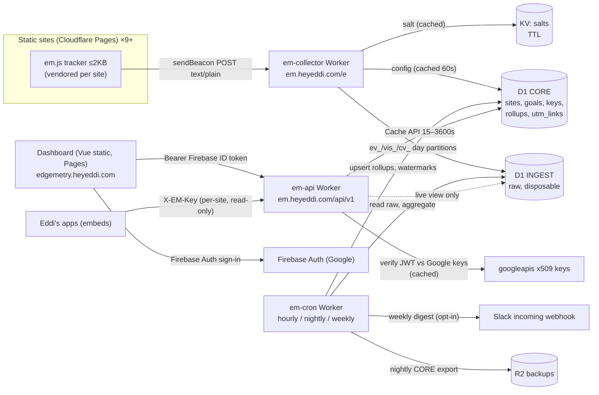

# HeyEddi Edgemetry — Technical Spec (v0.1 draft)

Owner: Eddi Sanchez · Date: 2026-10-04 · Status: draft for build
Inspired by (MIT) [hayaran/Edgemetry](https://github.com/hayaran/Edgemetry). From-scratch implementation; no code copied.

**Legend:** ✅ = verified against official docs on 2026-10-04 (URL cited). ⚠️ = unverified / from memory / my assumption. Verify before relying on it.

---

## 1. Goals / Non-goals

**Goals**
1. Cookieless, privacy-first analytics for ~9+ owned sites: climb, egregor-app, nunuvi, helpus, proven3, jobworth, heyeddi, CI.heyeddi.com, buybetter.
2. Runs on Cloudflare free tier (Workers + D1 + Pages), ~$0/month at current traffic, with a clean upgrade path to Workers Paid.
3. Growth features Edgemetry lacks: **first-touch-per-visit attribution** (utm + channel-grouped referrer) so goals/signups are attributed to a source and per-source conversion rate is computable; goals; UTM link builder; cross-site overview; CSV/JSON export; opt-in weekly Slack digest; **per-site timezone** (America/Mexico_City), not all-UTC.
4. Dashboard = Vue static page on Pages. Small read-only JSON API; per-site scoped keys so Eddi's own apps can embed mini dashboards.
5. Solo-maintainable: 3 small Workers, 2 D1 databases, one static dashboard.

**Non-goals**
- Not multi-tenant SaaS (a fixed allowlist of Eddi-owned sites; no public signup, no billing).
- No user-level tracking, sessions replay, heatmaps, cross-device/cross-site identity, ads/retargeting.
- No third-party requests from tracked sites (no CDN scripts, fonts, geo APIs).
- Not a replacement for product analytics with event properties/funnels (deferred, §12).
- No real-time at sub-minute precision; "live" = last ~30 min, cached 15 s.

---

## 2. Privacy model

### 2.1 What is / isn't stored

| Data | Handling |
|---|---|
| IP address | Read from `CF-Connecting-IP` in memory only: hashed, and country derived from `request.cf.country` ⚠️. **Never stored, never logged.** |
| User-Agent | In memory only: hashed, and reduced to coarse `device` (desktop/mobile/tablet), `browser` family, `os` family. Raw UA never stored. |
| Visitor ID | `vh` = first 16 bytes of `SHA-256(salt ‖ 0x00 ‖ sid ‖ 0x00 ‖ ip ‖ 0x00 ‖ ua)`. IPv6 truncated to /64 before hashing. Salt is secret, random, per site per local day, **expires ~6 h after the local day ends** (see 2.2, 4.2). `sid` in the hash ⇒ the same person on two sites gets unrelated hashes (no cross-site linking). |
| URL | Pathname only (no query string, no hash unless `data-hash-mode`). Optional per-site masking (`data-mask`) for ID-like segments. Max 256 chars. |
| Referrer | Hostname only (path/query dropped). Own-domain referrers ignored. |
| UTM | `utm_source/medium/campaign/content/term` (+ `ref`/`via` fallback), lowercased, ≤100 chars, charset-restricted; values containing `@` or looking like emails are dropped. |
| Timestamps | Server time only (never client time). |
| Custom events | Name only (≤64 chars, `[a-z0-9_:.-]`). **No properties in v1.** |
| Never | Cookies, localStorage/sessionStorage/IndexedDB, canvas/font/screen/audio fingerprinting, client-side IDs, Firebase Analytics, third-party calls, raw IP/UA, email/user IDs, query strings. |

### 2.2 How visits are identified without cookies
- **Visit ≡ (site, local salt-day, `vh`)** — i.e. a "daily visitor". The first pageview of a `vh` in a day creates one row in `vis_<day>` holding the **first-touch** source (utm/referrer/channel/country/device/entry path). Everything later that day (pageviews, goals) is attributed to it by joining on `vh`.
- Salt window = **site-local day** (not UTC day) so "visitors per day" aligns with Eddi's reporting day and isn't double-counted across 18:00 local (UTC midnight). *Deliberate deviation from "same UTC day"; see Open Question Q1.*
- Salts live in **Workers KV with TTL** (not D1) so Time Travel history can't resurrect them (see 10.1). ⚠️ KV `expirationTtl` not re-verified; fallback = D1 `salts` table with disclosure.

### 2.3 Tradeoffs (document in dashboard "About data")
- Unique visitors are **daily**; multi-day "visitors" = sum of visitor-days (label it so).
- Shared IP+UA (offices/NAT) merge; mobile IP change mid-day splits one person into two (inflates visitors, can re-attribute as "direct").
- Returning next day = new visitor. No cross-device. No true sessions/bounce/duration in v1.
- First-touch-per-day: a visitor arriving "direct" at 09:00 and from HN at 15:00 is credited to Direct. Optional v1.1 "upgrade direct" rule: one `UPDATE … WHERE channel='direct'` when a later non-direct, non-internal touch appears.
- Bots/spoofing: inflate counts but cannot expose personal data.

### 2.4 DNT / GPC (optional)
Per-site `honor_dnt` (default off) + tracker attribute `data-respect-dnt`. When on: tracker sends nothing if `navigator.doNotTrack === '1'` or `navigator.globalPrivacyControl === true`; collector also drops requests with header `DNT: 1` or `Sec-GPC: 1`. (`globalPrivacyControl` is experimental/limited availability ✅ [MDN](https://developer.mozilla.org/en-US/docs/Web/API/Navigator/globalPrivacyControl), so the server header check is the reliable path.)

### 2.5 GDPR notes — **not legal advice** ⚠️ (all from memory; get counsel/DPA guidance before relying)
- IP is generally treated as personal data; Edgemetry processes it transiently in memory for hash+country and doesn't store/log it. Cloudflare still sees it as network processor.
- Nothing is stored on/read from the device ⇒ the ePrivacy "consent for storage/access" trigger is arguably not hit, but national regulators differ on whether any analytics is consent-exempt (e.g. conditions on purpose, retention, no cross-site tracking). Per-site config can force `honor_dnt`, and a "disable analytics" privacy-page toggle is a v1.1 option.
- At-rest data is pseudonymous (`vh`, short-lived) then aggregated; no way to look up "a person's data" ⇒ access/erasure requests can't be actioned against an identifier (document this).
- **Retention disclosure must include Time Travel**: pseudonymous raw rows dropped from the live DB within ~3 days still exist in D1 point-in-time history for up to 7 days (Free) / 30 days (Paid) ✅ (§10). State this honestly in the privacy page.
- Put a short privacy notice link on each site; keep a record of processing (Art. 30-style) in the repo.
- Never enable Workers Logs/Logpush on the collector without checking they don't capture IPs (§11).

---

## 3. Architecture



**Components**
- `em-collector` (public, write path), `em-api` (read path + admin), `em-cron` (scheduled). Shared TypeScript package. Separate Workers = separate failure domains and clear least-privilege bindings.
- **Two D1 DBs** (Free allows 10 DBs ✅):
  - `INGEST`: raw per-day partitions + conversions; disposable; never backed up.
  - `CORE`: config + all rollups; backed up (§10). Splitting means export (which blocks DB requests while running ✅) never blocks ingestion, and backups don't contain pseudonymous raw rows or salts.
- Hostnames (assumes heyeddi.com DNS on Cloudflare ⚠️): `em.heyeddi.com` = Worker custom domain (collector + API; needed for working Cache API ✅); `edgemetry.heyeddi.com` = dashboard on Pages.
- "No third-party requests": the beacon goes to an Eddi-owned domain (first-party in ownership, cross-origin technically). Optional later: per-site `a.<site>` CNAME to the Worker (Worker custom domains: 100 per zone ✅).

---

## 4. Data model

Conventions: `sid` = small integer site id (sites.slug is the public id). `day` = `YYYY-MM-DD` in the **site's timezone**; partition suffix `YYYYMMDD` of that local date. `ts` = unix seconds UTC. Composite-PK `WITHOUT ROWID` tables on purpose: **every secondary index costs an extra row written per insert** ✅.

### 4.1 CORE (config + rollups, kept forever unless noted)
```sql
CREATE TABLE sites (
  sid INTEGER PRIMARY KEY, slug TEXT UNIQUE NOT NULL, name TEXT NOT NULL,
  domains TEXT NOT NULL,                       -- JSON array of allowed hostnames
  tz TEXT NOT NULL DEFAULT 'America/Mexico_City',  -- IANA; whole-hour UTC offsets only in v1
  honor_dnt INTEGER NOT NULL DEFAULT 0, ingest_paused INTEGER NOT NULL DEFAULT 0,
  digest_enabled INTEGER NOT NULL DEFAULT 0, created_at INTEGER NOT NULL);

CREATE TABLE site_members (               -- Firebase UID allowlist per site
  sid INTEGER NOT NULL, firebase_uid TEXT NOT NULL,
  role TEXT NOT NULL CHECK (role IN ('owner','viewer')),
  PRIMARY KEY (sid, firebase_uid)) WITHOUT ROWID;

CREATE TABLE api_keys (
  key_id TEXT PRIMARY KEY, sid INTEGER NOT NULL, label TEXT,
  key_hash BLOB NOT NULL,                  -- SHA-256 of secret; secret shown once
  scopes TEXT NOT NULL,                    -- e.g. 'summary,timeseries,sources'
  allowed_origins TEXT NOT NULL,           -- JSON array
  created_at INTEGER NOT NULL, last_used_day TEXT, revoked_at INTEGER);

CREATE TABLE goals (
  goal_id INTEGER PRIMARY KEY, sid INTEGER NOT NULL, name TEXT NOT NULL,
  kind TEXT NOT NULL CHECK (kind IN ('event','path')),
  match_type TEXT NOT NULL CHECK (match_type IN ('exact','prefix')),
  pattern TEXT NOT NULL,                   -- event name, or path
  active INTEGER NOT NULL DEFAULT 1, created_at INTEGER NOT NULL);

CREATE TABLE utm_links (
  id INTEGER PRIMARY KEY, sid INTEGER NOT NULL, label TEXT, base_url TEXT NOT NULL,
  utm_source TEXT, utm_medium TEXT, utm_campaign TEXT, utm_content TEXT, utm_term TEXT,
  full_url TEXT NOT NULL, created_at INTEGER NOT NULL);

-- Rollups
CREATE TABLE stats_hourly (               -- UTC hour buckets; 90-day retention
  sid INTEGER NOT NULL, hour_ts INTEGER NOT NULL,
  pv INTEGER NOT NULL DEFAULT 0, ev INTEGER NOT NULL DEFAULT 0,
  new_visits INTEGER NOT NULL DEFAULT 0,
  PRIMARY KEY (sid, hour_ts)) WITHOUT ROWID;

CREATE TABLE stats_daily (                -- kept forever
  sid INTEGER NOT NULL, day TEXT NOT NULL,
  dim TEXT NOT NULL,   -- total|path|entry|ref_host|country|device|browser|os|event
  k TEXT NOT NULL,     -- dimension value ('' for total); top-N + '(other)'
  pv INTEGER NOT NULL DEFAULT 0, visits INTEGER NOT NULL DEFAULT 0, events INTEGER NOT NULL DEFAULT 0,
  PRIMARY KEY (sid, day, dim, k)) WITHOUT ROWID;

CREATE TABLE sources_daily (              -- attribution core; kept forever
  sid INTEGER NOT NULL, day TEXT NOT NULL, channel TEXT NOT NULL,
  source TEXT NOT NULL DEFAULT '', medium TEXT NOT NULL DEFAULT '', campaign TEXT NOT NULL DEFAULT '',
  visits INTEGER NOT NULL, pv INTEGER NOT NULL,
  PRIMARY KEY (sid, day, channel, source, medium, campaign)) WITHOUT ROWID;

CREATE TABLE goals_daily (                -- unique converting visitors per source; kept forever
  sid INTEGER NOT NULL, day TEXT NOT NULL, goal_id INTEGER NOT NULL, channel TEXT NOT NULL,
  source TEXT NOT NULL DEFAULT '', medium TEXT NOT NULL DEFAULT '', campaign TEXT NOT NULL DEFAULT '',
  converters INTEGER NOT NULL,
  PRIMARY KEY (sid, day, goal_id, channel, source, medium, campaign)) WITHOUT ROWID;

CREATE TABLE rollup_state (job TEXT NOT NULL, scope TEXT NOT NULL, value TEXT NOT NULL,
  PRIMARY KEY (job, scope)) WITHOUT ROWID;   -- watermarks, day-closed flags
```
Per-source conversion rate = `goals_daily.converters / sources_daily.visits` on the same `(channel,source,medium,campaign)` key (summed over range). Goal `kind` 'path' matches pageview path; 'event' matches custom event name.

### 4.2 INGEST (raw; per **local-date** partitions, created ahead by cron, **dropped** ~3 days later)
```sql
CREATE TABLE ev_20261004 (               -- one row per pageview/event
  id INTEGER PRIMARY KEY,                -- rowid = rollup watermark
  sid INTEGER NOT NULL, ts INTEGER NOT NULL,
  k INTEGER NOT NULL,                    -- 0 = pageview, 1 = custom event
  name TEXT, path TEXT NOT NULL, vh BLOB NOT NULL,
  nv INTEGER NOT NULL DEFAULT 0);        -- 1 if this pageview started the visit

CREATE TABLE vis_20261004 (              -- one row per visit = FIRST-TOUCH attribution
  sid INTEGER NOT NULL, vh BLOB NOT NULL, first_ts INTEGER NOT NULL,
  channel TEXT NOT NULL, source TEXT, medium TEXT, campaign TEXT, content TEXT, term TEXT,
  ref_host TEXT, entry_path TEXT, country TEXT, device TEXT, browser TEXT, os TEXT,
  PRIMARY KEY (sid, vh)) WITHOUT ROWID;

CREATE TABLE cv_20261004 (               -- one row per (visit, goal): first conversion only
  sid INTEGER NOT NULL, vh BLOB NOT NULL, goal_id INTEGER NOT NULL, ts INTEGER NOT NULL,
  channel TEXT NOT NULL, source TEXT, medium TEXT, campaign TEXT,   -- COPIED from vis_ at conversion time
  PRIMARY KEY (sid, vh, goal_id)) WITHOUT ROWID;
```
KV: `salt:{sid}:{YYYYMMDD}` → 32 random bytes (base64), TTL set so it expires ≤ ~6 h after that local day ends. Created by cron up to 24 h ahead (avoids KV negative-cache/eventual-consistency races ✅ [KV consistency](https://developers.cloudflare.com/kv/concepts/how-kv-works/)).

### 4.3 Attribution approach (fixes Edgemetry's gap)
1. Pageview arrives → collector computes `vh`, `channel/source/medium/campaign` (pure function, §4.4) and issues, in one `db.batch` (a transaction ✅):
   ```sql
   -- 1) event, flagged if it starts the visit (evaluated BEFORE the visit insert)
   INSERT INTO ev_D (sid,ts,k,path,vh,nv)
     VALUES (?,?,0,?,?, NOT EXISTS (SELECT 1 FROM vis_D WHERE sid=? AND vh=?));
   -- 2) first-touch visit; inserts 0 rows (0 writes) if one exists
   INSERT INTO vis_D (...) SELECT ?,?,?,... WHERE NOT EXISTS (SELECT 1 FROM vis_D WHERE sid=? AND vh=?);
   ```
2. Custom event / path-goal hit → 1 event row, plus if it matches an active goal (goal list cached in isolate 60 s):
   ```sql
   INSERT INTO cv_D (sid,vh,goal_id,ts,channel,source,medium,campaign)
   SELECT ?,?,?,?, v.channel,v.source,v.medium,v.campaign FROM vis_D v
   WHERE v.sid=? AND v.vh=? AND NOT EXISTS (SELECT 1 FROM cv_D WHERE sid=? AND vh=? AND goal_id=?);
   ```
   If no `vis_` row exists (collector missed the pageview), channel = `(unknown)`.
3. Day close: `sources_daily` ← GROUP BY over `vis_D` (+ pv via join to `ev_D` on `(sid,vh)`); `goals_daily` ← GROUP BY over `cv_D`. Conversion rate = converters / visits per source key.
4. Non-retroactive: goal definitions and channel map apply at ingest; raw data lives only ~3 days so only a 3-day recompute window exists.
5. Using `INSERT … WHERE NOT EXISTS` (not `INSERT OR IGNORE`) is meant to make "no write when already present" deterministic: D1 defines rows written as rows actually inserted/updated/deleted ✅, but confirm the no-op case in the spike ⚠️.

### 4.4 Channel grouping (`channels.json`, versioned in repo)
Precedence: (1) `utm_medium` ∈ {cpc,ppc,paid*} → **Paid**; `email|newsletter` → **Email**; (2) `utm_source` alias map (twitter|x|t.co→X, hn|hackernews→Hacker News, …); (3) else referrer host map; (4) else **Direct**. Self-referral (host ∈ site.domains) → ignored. Referrer host in another Eddi site → **Own sites** (source = that host; measures cross-promo).
Channels: Direct · Organic Search (google.*, bing, duckduckgo, ecosia, brave, yandex, baidu) · Hacker News · X · Reddit · LinkedIn · Dev.to · Product Hunt · GitHub · YouTube · Facebook/Instagram · Mastodon/Bluesky/Threads · Medium/Hashnode · Indie Hackers/Lobsters · AI assistants (chatgpt.com, perplexity.ai, claude.ai, gemini.google.com) · Email · Paid · Own sites · Referral (other) · (unknown).
Stored on the visit row at ingest (`ref_host` and raw utm also stored, so mapping can be fixed for future days).

### 4.5 Timezone handling
- Each site has `tz` (IANA). Collector derives `local_day = Intl.DateTimeFormat('en-CA',{timeZone}).format(now)` ⚠️ (Intl in workerd not re-verified) → partition, salt key, `day` columns.
- `stats_hourly` is UTC-hour bucketed; the API converts to local hours (whole-hour offsets only in v1; 30/45-min zones unsupported — Q4). DST days (23/25 h) fall out of the local-date logic. Mexico City currently has no DST ⚠️ (verify against tzdata).
- Daily rollups are computed **at local-day close + 60 min grace** from that local date's partition, so "yesterday" in the dashboard means Eddi's yesterday.
- Cron schedules are UTC only ✅ ([Cron Triggers](https://developers.cloudflare.com/workers/configuration/cron-triggers/)); jobs decide per site what's closed.

### 4.6 Write-budget math (Free: 100,000 rows written/day, resets 00:00 UTC ✅)
Counting rule ✅: each inserted/updated/deleted row = 1; each secondary index entry = +1; row width irrelevant ([D1 pricing](https://developers.cloudflare.com/d1/platform/pricing/)). We avoid secondary indexes.

Per pageview: `1 (ev row) + 1/ppv (new vis row)`, where ppv = pageviews per visitor-day. Edgemetry's ~1.2 writes/pv → ours ≈ **1.6 at ppv=1.6** (the +0.4–0.6 is the price of attribution).
Per custom event: 1. Per first conversion/visitor/goal/day: 1.
Overhead/day (estimate, measure in spike): hourly upserts ≈ 9×24 = 216; daily rollup rows ≈ 9 sites × ~100–400 = 0.9–3.6k; salts ≈ 9 KV writes (KV, not D1); partition DDL (unknown, ⚠️). Reserve **5k**, plus **10% headroom**.

| Pageviews/day (all sites) | Custom events | Writes/day ≈ | % of 100k |
|---|---|---|---|
| 5,000 | 500 | 5,000×1.625 + 500 + 5,000 = ~13.6k | 14% |
| 20,000 | 3,000 | 32.5k + 3k + 5k = ~40.5k | 41% |
| 50,000 | 5,000 | 81.3k + 5k + 5k = ~91.3k | 91% ⚠️ ceiling |

**Ceiling ≈ 50k pageviews/day** total at ppv≈1.6. Other ceilings that may bind first:
- **Workers Free: 100,000 requests/day for the whole account** ✅ ([limits](https://developers.cloudflare.com/workers/platform/limits/)) — every beacon, API call, cron run, and *Pages Functions* call from any of Eddi's Workers counts. Over-limit ⇒ Error 1027 (route fail-open or fail-closed configurable). Set collector route **fail open**.
- D1 over-limit ⇒ queries error for the account (all D1 users, not just Edgemetry) ✅ → collector must **fail silent** (204) and shed load; budget gauge in dashboard (§9).
- Reads: 5M/day ✅; rollups read each raw row ~once per dimension; fine to ~50k pv/day.
- Storage: Free = 500 MB/DB ✅, 5 GB/account ✅; stats_daily ≈ 9 sites×~150 rows×365 ≈ 500k rows/yr (est. ~50–80 MB ⚠️).
- Upgrade path: Workers Paid removes daily caps and uses monthly included quotas (50M rows written/mo ✅; $ price of Paid plan ⚠️ not fetched).

---

## 5. Tracker script API

**Install** (preferred: vendor `em.js` into each site's build so it's same-origin and cached by the site; or load from dashboard origin):
```html
<script defer src="/em.js" data-site="climb"></script>
```
**Attributes**

| Attribute | Default | Meaning |
|---|---|---|
| `data-site` | required | site slug |
| `data-api` | `https://em.heyeddi.com/e` | collector URL |
| `data-spa` | `auto` | `auto` patches `history.pushState/replaceState` + `popstate`; `off` = manual only |
| `data-hash-mode` | off | include `location.hash` path (hash routers) |
| `data-auto` | `true` | `false` = don't auto-send pageviews |
| `data-respect-dnt` | off | honor DNT/GPC client-side |
| `data-exclude` | — | comma list of path prefixes/globs never sent (`/admin,/preview`) |
| `data-mask` | — | path patterns to collapse, e.g. `/u/*,/invoice/*` → `/u/:x` |

**JS API**
```js
edgemetry('pageview')                      // manual (SPA frameworks with data-spa=off)
edgemetry('event', 'signup')               // custom event / goal trigger; name ≤64, [a-z0-9_:.-]
edgemetry('event', 'checkout_started')
// queue stub (so calls before load are kept):
// window.edgemetry = window.edgemetry || function(){ (edgemetry.q = edgemetry.q || []).push(arguments) }
```
Vue/Firebase example: after `createUserWithEmailAndPassword` resolves → `edgemetry('event','signup')`.

**Behavior**
- Transport: `navigator.sendBeacon(api, new Blob([json], {type:'text/plain'}))` (no CORS preflight; 64 KiB cap ✅ [MDN](https://developer.mozilla.org/en-US/docs/Web/API/Navigator/sendBeacon)); fallback `fetch(..., {method:'POST', keepalive:true, body})`. No unload/duration beacon in v1.
- Payload (compact JSON, <1 KB): `{s, k:'pv'|'ev', n, p, r, us, um, uc, ut, ux, rf}` where `us…ux` = whitelisted utm values and `rf` = `ref`/`via`. `r` (document.referrer) only sent on first pageview of a page load. No screen size, language, timezone, plugin, or other fingerprint-able fields. Query string and hash never sent.
- SPA: on route change send a `pv` (debounced 50 ms, skip if same path); on SPA nav `r` omitted; UTM sent only if present in `location.search`.
- Skips: `prerender`/hidden-prerender, `navigator.webdriver`, excluded paths, DNT/GPC if enabled, `localhost`/`file:`.
- Size target ≤ 2 KB gzipped; no dependencies; ES2017; errors swallowed.
- Host-site CSP must allow `connect-src https://em.heyeddi.com`.

---

## 6. Collector endpoint

`POST https://em.heyeddi.com/e`  (also `OPTIONS`)
- Body: JSON (≤2 KB, `Content-Type: text/plain` or `application/json`).
- Responses: `204` accepted **or silently dropped** (bot, unknown site, paused, DNT, budget shed); `400` malformed; `413` too large; `429` rate-limited. Always `Cache-Control: no-store`; **never `Set-Cookie`**. CORS: `Access-Control-Allow-Origin` = validated request Origin, `Vary: Origin`; preflight `204` with `Allow-Methods: POST`, `Allow-Headers: Content-Type`, `Max-Age: 86400`. ⚠️ Beacon CORS/credentials behavior differs per browser — test Chrome/Safari/Firefox in spike.

**Pipeline**
1. Size/JSON/field validation (types, lengths; `p` starts with `/`; `r` parsed with `URL`, http(s) only).
2. Site lookup by slug from isolate cache (60 s TTL, serve stale on D1 error); unknown or `ingest_paused` ⇒ 204 drop (no D1 write).
3. Origin check: `Origin` (or `Referer` host) ∈ `site.domains`; else drop.
4. DNT/GPC if `honor_dnt`. Bot filter: empty UA / UA regex (bot|crawl|spider|headless|lighthouse|curl|wget|python-requests|go-http…) ; optional hosting-ASN heuristic via `request.cf.asn` ⚠️.
5. Rate limit via Rate Limiting binding with two keys: `sid` (site-wide cap) and `sid` + coarse IP-hash (in memory only, never stored). Binding semantics ✅: `period` must be 10 or 60 s; counters are **per Cloudflare location, permissive/eventually consistent** ([docs](https://developers.cloudflare.com/workers/runtime-apis/bindings/rate-limit/)); treat as a damper, not accounting.
6. Salt from isolate cache → KV; compute `vh`, local day, channel, device/browser/os, country.
7. Respond `204` immediately; run the D1 `batch` in `ctx.waitUntil` (≤30 s after response ✅). On `no such table: ev_D` ⇒ create partition and retry once. On D1 daily-limit error ⇒ drop silently and set an in-isolate "shed" flag for 60 s.
8. Event-name cardinality guard: per site/day max 100 distinct names (cron maintains allow-set; others → `(other)`).

CPU: Free = 10 ms/request ✅; SHA-256 via WebCrypto and one batch should fit ⚠️ — measure in spike.
Statements per request: ≤3 (Free: 50 queries/invocation ✅).

---

## 7. Rollup jobs (`em-cron`)

Free: **5 cron triggers/account** (share with all Eddi Workers), 10 ms CPU per cron invocation, 15 min wall ✅. Cron changes take up to 15 min to propagate ✅. Design: SQL does the aggregation; JS only shuttles small result sets; upserts to CORE use **one statement with `json_each(?1)`** (⚠️ verify support) because D1 allows only 100 bound params/statement and 50 queries/invocation (Free) ✅ (batch counting of statements ⚠️ verify). Aggregations are **site-agnostic** (`GROUP BY sid`) so statement count doesn't scale with sites.

| Job | Cron (UTC) | Work |
|---|---|---|
| `hourly` | `5 * * * *` | (a) Ensure `ev_/vis_/cv_` partitions exist for today+tomorrow for each distinct site-local date; (b) incremental `stats_hourly`: read `ev_D WHERE id > watermark AND id <= max` grouped by `(sid, hour)` → additive upsert + watermark update in one CORE batch (atomic) ; (c) **close days**: for each site whose local day ended ≥60 min ago and isn't flagged done → compute `stats_daily` (dims: total, path[top 200], entry[200], ref_host[100], country, device, browser, os, event[100], with `(other)`), `sources_daily`, `goals_daily` from partition D; upsert with **replace** semantics (idempotent), set `rollup_state` done; (d) drop partitions whose date ≤ today−3 and all sites done (**`DROP TABLE`, not `DELETE`**: deletes cost 1 write/row ✅); (e) pre-create next-day salts in KV; (f) delete `stats_hourly` rows older than 90 days. |
| `nightly` | `0 9 * * *` (03:00 America/Mexico_City) | CORE export → R2 (§10); verify previous export exists; prune old exports. |
| `weekly` | `0 15 * * MON` (09:00 Mexico City) | Slack digest (opt-in sites). Use weekday names (numeric DOW is 1=Sunday ✅). |

Uses 3 of 5 triggers. Failures: each job idempotent; `rollup_state` makes reruns safe; alert (Slack, if configured) when a day is not closed 6 h after expected or a job errors twice.
Live ("today") views are computed from raw partitions on demand (same SQL builders as the daily job) and cached 15–60 s; revisit with hourly dim rollups if traffic grows.
Weekly/monthly aggregates are computed from `stats_daily` at query time.

---

## 8. Read API (`em-api`)

Base: `https://em.heyeddi.com/api/v1` · JSON · GET only for data · all dates are **site-local** `YYYY-MM-DD` inclusive; `grain=hour` returns ISO timestamps with offset.

### 8.1 Auth
1. **Dashboard / admin:** `Authorization: Bearer <Firebase ID token>`. Verify per Firebase docs ✅ ([verify-id-tokens](https://firebase.google.com/docs/auth/admin/verify-id-tokens)): RS256; `kid` ∈ keys from `https://www.googleapis.com/robot/v1/metadata/x509/securetoken@system.gserviceaccount.com` (cache keys in isolate per `Cache-Control: max-age`); `aud` = Firebase project ID; `iss` = `https://securetoken.google.com/<projectId>`; `sub` non-empty; `exp`/`iat`/`auth_time` sane. The Admin SDK needs a service account and Node — use WebCrypto/`jose` ⚠️ (library choice is my recommendation). Then authorize: `uid ∈ site_members` for the requested site, or `uid ∈ OWNER_UIDS` (Worker secret) for all. **Revocation is not checked by verification ✅** ⇒ sensitive admin actions (keys, members, deleting goals) require `auth_time` ≤ 5 min (force reauth). Token lifetime ≈ 1 h ⚠️.
2. **Embeds:** `X-EM-Key: emk_<key_id>_<secret>`; server compares SHA-256(secret) to `api_keys.key_hash` (constant-time), checks `revoked_at`, `scopes`, `Origin ∈ allowed_origins`, and that URL `site` == key's site. Keys are read-only, aggregate-only, scoped to ONE site, and **cannot** export or call admin routes. Treat as semi-public (will sit in client bundles): rate-limited per key, revocable, rotatable. `last_used_day` updated at most once/day/key (avoid write amplification).

### 8.2 Endpoints
| Method & path | Auth | Returns |
|---|---|---|
| `GET /sites` | ID token | sites the user may see + tz, goals |
| `GET /overview?from&to&compare=prev` | ID token | **cross-site**: per site `visits, pv, goals, delta%, sparkline` |
| `GET /sites/{slug}/summary?from&to` | token/key | visits, pv, events, goal totals, vs previous period |
| `GET /sites/{slug}/timeseries?metric=pv\|visits\|events&grain=hour\|day\|week\|month&from&to` | token/key | series (local buckets) |
| `GET /sites/{slug}/breakdown?dim=path\|entry\|ref_host\|country\|device\|browser\|os\|event&limit=50` | token/key | rows `{k, pv, visits, events}` |
| `GET /sites/{slug}/sources?level=channel\|source\|campaign&goal={id}` | token/key | `{channel,source,medium,campaign,visits,pv,converters,conv_rate}` |
| `GET /sites/{slug}/goals` / `GET /sites/{slug}/goals/{id}/conversions?by=channel\|source\|campaign` | token/key | per-source conversions + rate |
| `GET /sites/{slug}/live` | token | last 30 min: pv, top pages, top sources (from raw) |
| `GET /sites/{slug}/export?dataset=daily\|sources\|goals&format=csv\|json&from&to` | **ID token only** | rollup rows (never raw); ≤50k rows; CSV guards against formula injection (prefix `'` on cells starting `= + - @`) |
| Admin (owner + recent auth): `POST/PATCH /sites`, `POST/PATCH/DELETE /sites/{slug}/goals`, `POST/DELETE /sites/{slug}/api-keys`, `PUT /sites/{slug}/members`, `POST/GET/DELETE /sites/{slug}/utm-links`, `PATCH /sites/{slug}/digest` | ID token | CRUD |

Envelope: `{site, tz, from, to, grain, data, generated_at, ttl}`; errors `{error:{code,message}}` with `401/403/404/422/429`. `limit` ≤ 500.

### 8.3 CORS
`Access-Control-Allow-Origin` = request Origin **only if** allowed (dashboard origin for token calls; key's `allowed_origins` for key calls), else omitted; `Vary: Origin`; `Allow-Methods: GET, POST, PATCH, PUT, DELETE, OPTIONS`; `Allow-Headers: Authorization, X-EM-Key, Content-Type`; `Max-Age: 86400`; no credentials (no cookies ⇒ no CSRF surface).

### 8.4 Caching
Authenticate **first**, then `caches.default` keyed by canonical URL (+ scope marker; never serve one site's data to another). Cache API works on custom domains and is **per-data-center, not replicated** ✅ ([Cache API](https://developers.cloudflare.com/workers/runtime-apis/cache/)); `stale-while-revalidate` is not supported in `cache.put/match` ✅. TTLs: `live` 15 s; ranges including today 60 s; closed-day-only ranges 1 h; `overview` 60 s. Client response `Cache-Control: private, max-age=15..60`; add `ETag`. Rate limit per key and per uid with the Rate Limiting binding (damper only).

---

## 9. Dashboard (Vue 3 static on Pages)

Stack: Vue 3 + Vite + vue-router + Pinia; Firebase Auth modular SDK (Google sign-in); uPlot or Chart.js **self-hosted** (no CDN). `_headers`: strict CSP, `frame-ancestors 'none'`, `Referrer-Policy: no-referrer` (Pages `_headers`: 100 rules ✅). All server strings rendered as text (never `v-html`). SPA fallback routing ⚠️ (confirm Pages behavior or use hash router).

Views
1. **Overview (cross-site):** card grid, one per site: visits, pv, goals, Δ vs previous period, sparkline; sort/filter; site health (last event time; ingest paused).
2. **Site → Overview:** range picker (today/7/30/90/custom, in site tz), timeseries (hour/day/week/month), KPIs, top pages, top sources, countries, devices.
3. **Live:** last 30 min pageviews + pages + sources (15 s refresh).
4. **Sources:** channel table → drill to source/medium/campaign; columns visits, pv, **converters, conversion rate** per selected goal; sortable; compare periods.
5. **Goals:** CRUD (event or path; exact/prefix); per-goal trend and per-source conversion table.
6. **Pages:** top pages, entry pages, mask hints.
7. **Events:** custom event counts.
8. **UTM Link Builder:** inputs base URL (must match site domains), source/medium/campaign/content/term; lowercase + charset normalization; presets per channel (HN, X, Reddit, LinkedIn, Dev.to, newsletter); live URL preview, copy, save to `utm_links`, list saved.
9. **Export:** CSV/JSON of daily/sources/goals for a range.
10. **Settings (owner):** site tz, domains, honor DNT, pause ingest, goals, API keys (create-once reveal, revoke, allowed origins, scopes), members (Firebase UIDs), Slack digest toggle.
11. **Data budget:** estimated writes today vs 100k (from `stats_hourly` × factor; optionally CF GraphQL analytics ⚠️), requests/day estimate, shed-mode indicator, last backup time.
12. **Embeddable `<EdgemetryMini>`** Vue component (+ vanilla snippet): sparkline + KPIs from key-scoped API.

Slack digest (weekly, opt-in per site): Mon 09:00 local; per site: visits & pv with Δ vs prior week, top 3 sources with conv rate, top 3 pages, goal totals, anomaly flag (>3× median). Delivered via Slack incoming webhook (JSON POST; URL contains a secret; channel fixed by webhook ✅ [Slack docs](https://docs.slack.dev/messaging/sending-messages-using-incoming-webhooks/)) stored as Worker secret. Contains no personal data.

---

## 10. Backup plan for D1

### 10.1 Time Travel (built-in) ✅ — [Time Travel](https://developers.cloudflare.com/d1/reference/time-travel/) · [Limits](https://developers.cloudflare.com/d1/platform/limits/) (both "last updated Apr 21, 2026")
- Always on, no cost, bookmarks automatic; restore to any minute within **30 days (Workers Paid) / 7 days (Workers Free)**. (The Time Travel page's headline says "30 days"; the Limits table and Notes make clear Free = 7.)
- Requires `version: production` DB (`wrangler d1 info`), Wrangler ≥ 3.4.0.
- Restore is **destructive, in place** (overwrites DB; in-flight queries cancelled); returns a pre-restore bookmark for undo. Max 10 restores / 10 min / DB. No clone/fork yet ✅.
- Commands: `wrangler d1 time-travel info CORE [--timestamp=…]`, `wrangler d1 time-travel restore CORE --timestamp=<unix>`.
- Caveats: (1) retention is the same short window — not an archive; (2) history includes pseudonymous raw rows in INGEST (disclose, §2.5); salts are in KV so they are not in history.

### 10.2 Logical export to R2 (long retention) ✅ pattern
- Nightly `em-cron` job calls the D1 export REST API `POST /accounts/{id}/d1/database/{db}/export` (poll with `current_bookmark` until `signed_url`), streams the SQL to R2. Official example uses a Workflow with a `schedules` cron ([Export and save D1 database](https://developers.cloudflare.com/workflows/examples/backup-d1/)); Workflows limits table has a Free column (100k executions/day shared with Workers, 3-day instance retention) ✅ ([limits](https://developers.cloudflare.com/workflows/reference/limits/)). Simpler alternative: do the poll loop in the cron Worker (wall-time not CPU-bound ✅) — ⚠️ pick after spike.
- API token: least-privilege D1 export token as Worker secret ⚠️ (exact permission name unverified).
- **CORE only** (config + rollups; small). Not INGEST, not KV.
- **A running export blocks other requests to that DB ✅** ⇒ run at 03:00 local; collector serves stale config from cache during it. (Reason CORE and INGEST are separate.)
- R2: Free tier 10 GB-month, 1 M Class A, 10 M Class B ✅ ([R2 pricing](https://developers.cloudflare.com/r2/pricing/)) — plenty. Retention: 30 daily + 12 monthly; prune in the nightly job (deletes are free ✅).
- Per-table exports possible (`wrangler d1 export --table`); `--no-data` for schema ✅ ([import/export](https://developers.cloudflare.com/d1/best-practices/import-export-data/)).

### 10.3 Offline copy & drills
- Monthly manual `wrangler d1 export CORE --remote --output=core-YYYY-MM.sql` from Eddi's machine → Google Drive (3-2-1).
- Quarterly **restore drill** into a scratch D1: `wrangler d1 execute <scratch> --remote --file=…` (limits: 5 GiB file; 100 KB per SQL statement ⇒ split large INSERTs ✅; export has 52-bit JS integer precision caveat ✅ — irrelevant for our values).
- Targets: RPO ≈ 1 min via Time Travel (≤7 d), ≤24 h via R2; RTO < 1 h. Migrations: take bookmark before every schema migration (`time-travel info`) and record it in the PR.

---

## 11. Security

| Threat | Mitigation |
|---|---|
| **Ingest abuse / inflation / budget exhaustion** | Public `site` slug is not a secret ⇒ anyone can POST. Layers: size cap 2 KB; strict validation; unknown-site drop with no DB write; Origin/Referer allowlist; Rate Limiting binding per site & per coarse IP-hash (per-colo, permissive ✅); per-site `ingest_paused` kill switch; cardinality caps (event names, paths, utm values); shed mode when D1 limit hit; anomaly flag in digest; optional Cloudflare WAF rate rule on `/e` ⚠️ (free-plan availability unverified). |
| **Domain forgery** | `Origin` is browser-enforced but trivially spoofed from scripts ⇒ origin check only stops casual/browser-based abuse. Accept: forged hits can't expose data, only skew counts. Mitigate with rate limits, daily anomaly review, and ability to purge a bad day (drop partition + recompute is only possible within ~3 d; otherwise delete `stats_*` rows for that day). |
| **Data poisoning via UTM/referrer/path** | Lowercase, length/charset limits, drop email-like values, strip query/hash, never store full URLs; dashboard renders text only (no `v-html`); CSV formula-injection guard. |
| **PII leakage in paths** | `data-mask`, `data-exclude`; docs: never put emails/tokens in paths. |
| **SQL injection** | Bound parameters only. Dynamic identifiers = partition names built from server-generated `YYYYMMDD` (regex-checked). |
| **Auth** | Firebase ID token fully validated (alg, kid, aud, iss, sub, exp, iat, auth_time) ✅; UID allowlist per site; revocation not checked ✅ ⇒ reauth (≤5 min `auth_time`) for admin; API keys hashed at rest, scoped, origin-restricted, revocable; no cookies ⇒ no CSRF; admin routes owner-only. |
| **Secrets** | Worker secrets: `FIREBASE_PROJECT_ID`, `OWNER_UIDS`, `SLACK_WEBHOOK_URL`, `CF_API_TOKEN` (export), channel list is code. Free: 64 vars/Worker, 5 KB each ✅. Rotate on suspicion; never log. |
| **Logs = privacy at rest** | Do not enable Workers Logs/Logpush on `em-collector` unless verified to omit IP/UA/URL ⚠️; log only counters (drop reasons). |
| **Dashboard hardening** | CSP, `frame-ancestors 'none'`, self-hosted assets only, Firebase Auth authorized domains restricted to dashboard origin. |
| **Availability** | Fail open for Worker-limit route behavior ✅; tracker never blocks page; collector never returns 5xx to beacons (swallow). |
| **Supply chain** | Minimal deps (`jose`, UA parser tiny or hand-rolled); lockfile; no runtime remote code. |

---

## 12. MVP milestones (6 weeks, part-time solo) and deferrals

**Week 0–1: Spike + foundations**
- Spike (1–2 days) to settle ⚠️ items: (1) `rows_written` for `INSERT … WHERE NOT EXISTS` no-op, (2) billing of `CREATE/DROP TABLE` partitions, (3) whether `db.batch` counts statements toward the 50/invocation Free cap, (4) `json_each` upsert, (5) sendBeacon CORS in Chrome/Safari/Firefox, (6) CPU ms of collector, (7) KV TTL salts.
- Repo (pnpm + wrangler + vitest/miniflare), CORE+INGEST schema/migrations, `sites` seed (9 sites), collector (pv only), tracker v0, partition manager. Dogfood on heyeddi.com.

**Week 2: Attribution & rollups**
- Channel map, vis/cv tables, events + goals matching, hourly + daily jobs, tz logic, salts in KV. Tests for tz/DST boundaries and attribution. Roll out to 3 sites.

**Week 3: API + auth + dashboard shell**
- Firebase ID token verification, member allowlist, read endpoints (summary/timeseries/breakdown/sources/goals), caching, CORS. Dashboard: login, overview, site overview.

**Week 4: Growth features**
- Sources + goals views with conversion rate, UTM link builder + saved links, CSV/JSON export, settings (goals, tz, domains). Roll out to all 9 sites.

**Week 5: Ops & integrations**
- API keys + embeds component, Slack weekly digest, nightly R2 export + restore drill, budget gauge, rate limits/caps/kill switch, privacy page + retention text.

**Week 6: Hardening**
- Synthetic load test (50k pv/day), failure drills (D1 limit, export blocking), docs, cut over from any existing analytics, retro.

**Deferred (post-MVP)**: event properties; funnels; public share links; bounce/engagement time/session depth; revenue/value on goals; server-to-server event API; "upgrade direct" attribution rule; last-non-direct attribution; per-site collector CNAMEs (ad-block resilience); 30/45-min timezones; region/city geo; email reports; retroactive goal recompute; multi-user invitation UI.

---

## 13. Open questions / risks

**Questions**
- Q1. Salt/visit window = site-local day (my proposal) vs UTC day (your spec). Local day makes daily uniques exact for CDMX; confirm.
- Q2. Is heyeddi.com DNS on Cloudflare (needed for `em.heyeddi.com` Worker custom domain + working Cache API)? Are all 9 sites' domains on Cloudflare (for optional per-site CNAMEs)?
- Q3. Sign-up flows: do any use another origin (central auth domain)? Cross-origin hops change `vh` (site is in the hash) and would break attribution — keep sign-in on the same origin (popup/redirect back) or accept.
- Q4. Any site needing a non-whole-hour tz? (Unsupported v1.)
- Q5. Stay on Free long-term? Whole-account caps (requests, D1 rows) are shared with Eddi's other Workers.
- Q6. Slack: one channel for all digests or per site? (Webhook = fixed channel.)
- Q7. Should server-side signups (Firebase Functions) be countable? Needs visitor context; deferred.

**Risks**
1. **D1 write accounting for partition DDL / drops and no-op inserts is unverified** (top spike item). Fallbacks: shorter raw retention, lower dims, or Workers Paid.
2. **Free-tier account-wide caps** (100k requests/day; 100k D1 rows/day): a traffic spike on one site starves all; mitigation = rate limits, per-site caps, shed mode, upgrade path.
3. Per-colo rate limiting is permissive; forged traffic can't be fully stopped.
4. Free cron CPU = 10 ms; heavy JS in rollups would fail ⇒ keep SQL-side aggregation; upgrade if needed.
5. D1 single-threaded per DB ✅: a long rollup query on INGEST delays collector writes ⇒ keep queries short, chunk work.
6. Time Travel history keeps pseudonymous raw data 7–30 days: disclosure required.
7. Cron propagation delay (≤15 min) and UTC-only schedules ✅.
8. Legal: GDPR/ePrivacy position unreviewed.
9. Browser quirks: Safari ITP/ad-blockers may block `em.heyeddi.com` (undercount); GPC API availability limited.
10. KV (eventual consistency, free 1,000 writes/day, 100k reads/day ✅) is fine for ~9 salt writes/day but cold-isolate salt reads add KV reads; cache aggressively.

---

## Appendix A — Verified facts (2026-10-04)

| Claim | Source |
|---|---|
| D1 Free: 5M rows read/day, 100k rows written/day, 5 GB storage; reset 00:00 UTC; index entries add written rows; DDL may count; DELETE counts as writes; exceeding free limit ⇒ D1 errors | https://developers.cloudflare.com/d1/platform/pricing/ (updated Apr 21, 2026) |
| D1 limits: 10 DBs & 500 MB/DB (Free); Time Travel 30 d Paid / 7 d Free; 10 restores/10 min; 50 queries/invocation (Free); 100 bound params; 100 KB statement; each DB single-threaded | https://developers.cloudflare.com/d1/platform/limits/ |
| Time Travel always on, restore in place (destructive), undo bookmark, no clone yet | https://developers.cloudflare.com/d1/reference/time-travel/ |
| `wrangler d1 export`; running export blocks other DB requests; import limits | https://developers.cloudflare.com/d1/best-practices/import-export-data/ |
| D1 export → R2 via REST + Workflow with `schedules` | https://developers.cloudflare.com/workflows/examples/backup-d1/ |
| Workflows Free column (100k exec/day shared; 3-day retention; 10 ms/step CPU) | https://developers.cloudflare.com/workflows/reference/limits/ |
| Workers Free: 100k req/day (Error 1027; fail open/closed), 10 ms CPU/request & cron, 50 subrequests, 5 crons/account, 64 env vars; cron wall 15 min; `waitUntil` ≤30 s | https://developers.cloudflare.com/workers/platform/limits/ |
| Cron triggers UTC-only; propagation ≤15 min; DOW 1=Sunday | https://developers.cloudflare.com/workers/configuration/cron-triggers/ |
| Rate Limiting binding: period 10 or 60 s; per-location; permissive | https://developers.cloudflare.com/workers/runtime-apis/bindings/rate-limit/ |
| Cache API: custom domains only; per-DC; no SWR in put/match | https://developers.cloudflare.com/workers/runtime-apis/cache/ |
| Firebase ID token verification rules; revocation not checked; key cache via max-age | https://firebase.google.com/docs/auth/admin/verify-id-tokens (updated 2026-10-01) |
| Pages: 100 projects, 100 custom domains/project (Free), 500 builds/mo, `_headers` 100 rules | https://developers.cloudflare.com/pages/platform/limits/ |
| KV Free: 100k reads/day, 1,000 writes/day, 1 write/s same key; eventually consistent (≥60 s) incl. negative lookups | https://developers.cloudflare.com/kv/platform/limits/ · https://developers.cloudflare.com/kv/concepts/how-kv-works/ |
| R2 free tier 10 GB-month / 1M Class A / 10M Class B; deletes free | https://developers.cloudflare.com/r2/pricing/ |
| `sendBeacon`: POST, 64 KiB cap | https://developer.mozilla.org/en-US/docs/Web/API/Navigator/sendBeacon |
| `navigator.globalPrivacyControl`: experimental, limited availability | https://developer.mozilla.org/en-US/docs/Web/API/Navigator/globalPrivacyControl |
| Slack incoming webhooks: JSON POST; secret URL; fixed channel | https://docs.slack.dev/messaging/sending-messages-using-incoming-webhooks/ |
| Firebase Auth Spark: 50K MAU (Identity Platform tier) | https://firebase.google.com/pricing |

## Appendix B — Unverified (⚠️) checklist
Workers `request.cf.country`/`asn` fields; `Intl.DateTimeFormat` tz support in workerd; D1 support for `json_each`; `db.batch` statement counting vs 50 cap; billing of DDL/no-op `INSERT…WHERE NOT EXISTS`; KV `expirationTtl`; Pages SPA fallback & unlimited static requests; Workers Paid price; CF API token permission for D1 export; Firebase ID token lifetime (~1 h); Mexico DST status; WAF rate-limit rules on Free plan; Workers Logs content (IP capture); all GDPR/ePrivacy statements; beacon CORS behavior per browser; `jose` on Workers.
